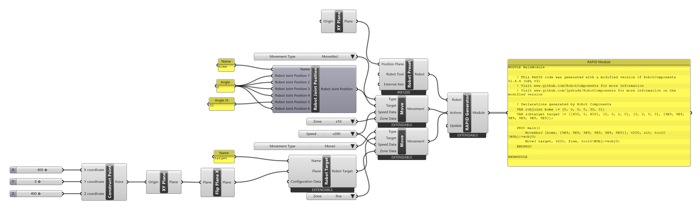
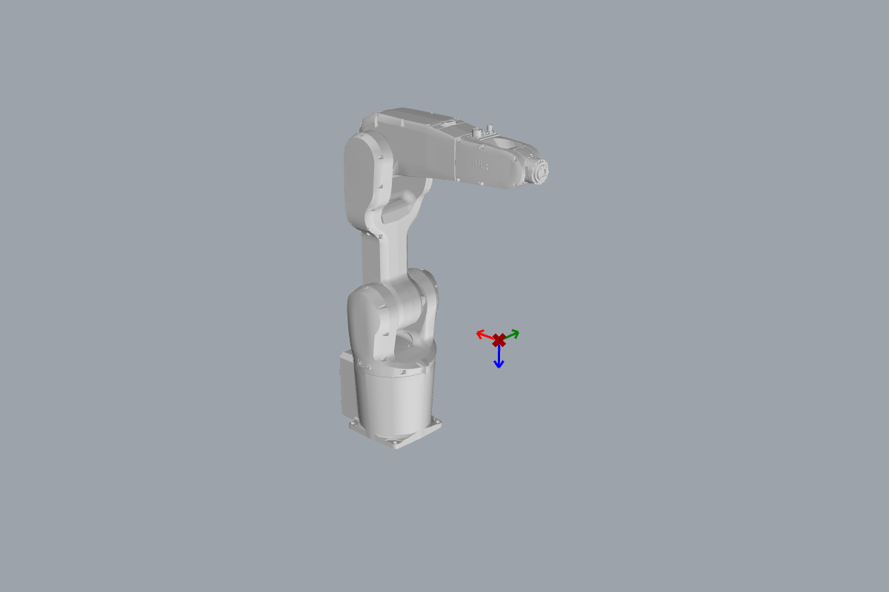

# Getting started

<span class="rc-badge rc-badge--verified">RAPID checked on IRB 1200 · RobotWare 6.10</span>

By the end of this page you will have a robot program that moves an ABB robot to a safe
pose and then to a point you choose, checked in Grasshopper and ready to upload.

## Install

1. **Rhino 7 or 8:** open the **Package Manager** (`_PackageManager`) and install
   *Robot Components*. Or download a release from
   [jpdrude/RobotComponents › Releases](https://github.com/jpdrude/RobotComponents/releases),
   copy the files into Grasshopper's *File › Special Folders › Components Folder*, and
   **unblock** each file (right-click › Properties › Unblock).
2. Restart Rhino. A new **Robot Components ABB** tab appears in Grasshopper.
3. **Only if you want to talk to a real or virtual controller** (upload, run, read
   signals): install [RobotStudio](https://new.abb.com/products/robotics/robotstudio) or the
   ABB Robot Communication Runtime. This only works on Windows. Everything else (building,
   simulating, generating code) needs nothing extra.

!!! tip "Units: always millimetres"
    Robot Components works in **millimetres**, whatever the units of your Rhino file.
    A Rhino file in metres will put a 400 mm target at 400 *metres*. Use a millimetre template.

## The toolbar

| Tab | What's in it | For example |
|---|---|---|
| Definitions | The robot, its tool, work objects, external axes | [[Robot Preset]] · [[Robot Tool]] · [[Work Object]] |
| Code Generation | Targets, movements, I/O and the code generator | [[Robot Target]] · [[Move]] · [[RAPID Generator]] |
| Simulation | Kinematics and path preview | [[Path Generator]] · [[Inverse Kinematics]] · [[Check Actions]] |
| Controller Utility | Connect to a controller, upload, run, read and write signals | [[Get Controller]] · [[Upload Program]] · [[Run Program]] |
| Multi Move | Several robots in one program | [[Task List]] · [[Sync Move On]] |
| Advanced RAPID Features | Variables, routines, loops, dialogs, interrupts ([Part B](../part-b/index.md)) | [[RAPID Variable]] · [[IF Statement]] · [[Routine]] |
| Utility, Deconstruct | Helpers, and components that take objects apart again | [[Flip Plane X]] · [[Group Actions]] · [[Deconstruct Robot Target]] |
| Parameters | Containers for every data type | [[type:Robot Target]] · [[type:Movement]] · [[type:Action]] |

## The one idea: a list of actions is the program

Almost every Robot Components component produces an **action**: an [[type:Action]] is one
step of the robot program, like "move there", "switch this output on" or "wait 2 seconds".

- **Instructions** do something: [[Move]], [[Set Digital Output]], [[Wait Time]], …
- **Declarations** describe data the instructions use: [[Robot Target]], [[Speed Data]],
  [[Zone Data]], … You rarely wire declarations into the generator yourself. A Move that
  uses a target makes the generator declare that target automatically.

You collect the instructions **in order** and give them to the [[RAPID Generator]]. The
order of the list is the order the robot executes them. That's all a program is.

## Your first program

[:material-download: first-program.gh](../examples/getting-started/first-program.gh){ .md-button download="first-program.gh" }

**Components used**

<div class="rc-used" markdown>
<span>[[Robot Preset]]</span>
<span>[[Robot Joint Position]]</span>
<span>[[Flip Plane X]]</span>
<span>[[Robot Target]]</span>
<span>[[Move]]</span>
<span>[[Movement Types]]</span>
<span>[[Predefined Speed Data]]</span>
<span>[[Predefined Zone Data]]</span>
<span>[[RAPID Generator]]</span>
</div>

Plus Grasshopper basics: [[gh:XY Plane]] · [[gh:Construct Point]] · [[gh:Number Slider]] · [[gh:Panel]]

<div class="rc-canvas" markdown>

</div>

Build it step by step:

1. **The robot.** Place [[Robot Preset]]. A dialog asks which robot; pick
   *IRB1200-5/0.9*. Feed its *Position Plane* with an [[gh:XY Plane]]: the robot stands at
   the world origin.
2. **A safe start pose.** Place [[Robot Joint Position]]: six joint angles in degrees.
   Give it a name (`home`) and set all angles to `0` except joint 5, which gets `30`. A
   straight wrist (joint 5 = 0) is a *singularity* the robot cannot move out of cleanly, so
   start bent.
3. **Where to go.** Three [[gh:Number Slider|Number Sliders]] (X 400, Y 0, Z 400) →
   [[gh:Construct Point]] → [[gh:XY Plane]] gives a plane 400 mm in front of the robot and
   400 mm up. Its Z axis points **up**, but the tool must point **down** at the table:
   [[Flip Plane X]] turns it over. [[Robot Target]] (name `target`) turns that plane into a
   [[type:Robot Target]].
4. **Two movements.** Two [[Move]] components:
    - the first goes to `home` with type `MoveAbsJ` (straight to joint angles),
    - the second goes to `target` with type `MoveJ` (fastest way there).

    Type, speed and zone come from [[Movement Types]], [[Predefined Speed Data]] and
    [[Predefined Zone Data]]. Each one turns into a drop-down list when you place it. The
    last movement uses zone `fine`: the robot stops exactly on the point.
5. **Generate.** Wire [[Robot Preset]] into *Robot* and **both** Moves into *Actions* of
   the [[RAPID Generator]], first `home`, then `target` (wire order = program order).
   Connect a [[gh:Panel]] to *Module* to read the result.



The red/green/blue arrows show the target's X/Y/Z axes. Blue (Z) is the direction the
tool will point.

??? example "Generated RAPID"
    ```
    MODULE MainModule
        VAR robjoint home := [0, 0, 0, 0, 30, 0];
        VAR robtarget target := [[400, 0, 400], [0, 0, 1, 0], [0, 0, 0, 0], [9E9, 9E9, 9E9, 9E9, 9E9, 9E9]];

        PROC main()
            MoveAbsJ [home, [9E9, 9E9, 9E9, 9E9, 9E9, 9E9]], v200, z10, tool0\WObj:=wobj0;
            MoveJ target, v200, fine, tool0\WObj:=wobj0;
        ENDPROC
    ENDMODULE
    ```
    (Header comments removed.) **Checked on a Virtual Controller** (IRB 1200-5/0.9,
    RobotWare 6.10): runs with no warnings, cycle time **2.6 s**.

## Upload and run

To run the program on a controller (a real robot, or a virtual one in RobotStudio):

1. [[Get Controller]] connects to a controller on your network or PC and outputs it.
2. [[Upload Program]] takes that controller and the *Module* text from the
   [[RAPID Generator]], and uploads it when *Upload* is `True`.
3. [[Run Program]] starts (*Run*), stops (*Stop*) or resets the program on the controller.

!!! danger "Real robots move"
    Before running on real hardware: test in RobotStudio first, run at reduced speed, keep
    the cell clear, and have the emergency stop within reach. The simulation in Grasshopper
    does **not** check collisions with your cell.

## Try it

- [ ] **Rename.** Change the target name from `target` to `pick`. Which two lines of RAPID change?
- [ ] **Move the target.** Drag the X slider. Watch the target frame move in Rhino and the coordinates change in the code.
- [ ] **Add a second target.** Add another [[Robot Target]] and [[Move]] (type `MoveL`) after the first. Where do you wire it so the robot goes there *last*?

??? success "Solutions"
    1. The declaration `VAR robtarget pick := …` and the instruction `MoveJ pick, …`.
    2. The first number in `[[400, 0, 400], …]` follows the slider.
    3. Into *Actions* of the [[RAPID Generator]], after the other two wires. The order of the wires is the order of the program.

## Where next?

- [Part A: Essentials](../part-a/index.md), starting with [[Move]], which drives a square with `MoveL`.
- [Part B: Advanced RAPID](../part-b/index.md) once you want variables, loops and decisions.
