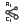

# { .rc-icon--title } Robot Kinematic Parameters

Definitions tab

The kinematics solver describes a standard six-axis robot (with a spherical wrist) by eight
lengths and offsets in mm: three offsets **A1–A3**, a lateral offset **B**, and four link
lengths **C1–C4**. Together with the joint limits they are all the solver needs to compute
poses. You need them for a custom [[Robot]]; presets already contain them.

### Robot Kinematic Parameters
[[io:Robot Kinematic Parameters]]

### Get Axis Planes from Robot Kinematics Parameters
[[io:Get Axis Planes from Robot Kinematics Parameters]]

This second component turns the parameters into the planes of the six joints, a quick visual
check that the numbers are right.

The parameter naming follows the ortho-parallel (OPW) kinematics model by Brandstötter,
Angerer and Hofbaur, which Robot Components uses for its solver (see the project README).

## See also

[[Robot]] · [[Inverse Kinematics]] · [[Deconstruct Robot Kinematic Parameters]]
