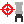

# { .rc-icon--title } Robot Tool Calibration

Utility tab

**Robot Tool Calibration** (marked *experimental*) works out where a tool's tip is. Jog the
robot so the tool tip touches **the same fixed point** from at least **4** different orientations (the component
errors with fewer),
read the joint positions (e.g. with [[Get Robot Joint Positions]]), and give them to this
component. The point that all poses have in common is the TCP.

[[io:Robot Tool Calibration]]

!!! tip "Prefer the controller's own TCP calibration"
    For production, use the controller's TCP definition on the FlexPendant (4-point or more),
    which is the established method. This component is useful to compare, or when you work
    from recorded joint positions.

## See also

[[Robot Tool]] · [[Get Robot Joint Positions]]
