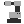

# { .rc-icon--title } Robot

Definitions tab

**Robot** builds a robot from scratch: its name, one mesh per link, its
[[Robot Kinematic Parameters]] and its joint limits. You only need it for a robot that isn't
in [[Robot Preset]], or a customised one. For ABB's catalogue robots, use the preset.

[[io:Robot]]

- **Name** must match the robot model on the controller (e.g. `IRB1200-5/0.9`).
- **Meshes**: one mesh per link, base first, in the robot's home pose (all joints at 0).
- **Axis Limits**: six intervals in degrees, from the robot's datasheet.

## See also

[[Robot Preset]] · [[Robot Kinematic Parameters]] · [[Deconstruct Robot]]
