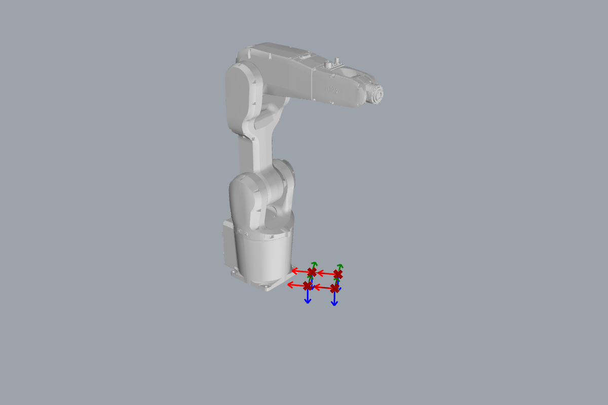

# { .rc-icon--title } Work Object

<span class="rc-badge">Definitions tab</span>
<span class="rc-badge rc-badge--verified">RAPID checked on IRB 1200 · RobotWare 6.10</span>

A **work object** is a coordinate system on the thing you work on: a table corner, a
fixture, a part. Program your targets **relative to it**, and when the table moves you only
re-measure the work object, not every target. Without one, the robot uses `wobj0`, its own base.

[[io:Work Object]]

## Example: a square drawn on a rotated table, with a pen

[:material-download: pen-on-table.gh](../../examples/part-a/pen-on-table.gh){ .md-button download="pen-on-table.gh" }

<div class="rc-used" markdown>
<span>[[Work Object]]</span>
<span>[[Robot Tool]]</span>
<span>[[Robot Preset]]</span>
<span>[[Robot Target]]</span>
<span>[[Move]]</span>
<span>[[Flip Plane X]]</span>
<span>[[RAPID Generator]]</span>
</div>

<div class="rc-canvas" markdown>

</div>



```
PERS tooldata pen := [TRUE, [[0, 0, 120], [1, 0, 0, 0]], [0.001, [0, 0, 0.001], [1, 0, 0, 0], 0, 0, 0]];
PERS wobjdata table := [FALSE, TRUE, "", [[0, 0, 0], [1, 0, 0, 0]], [[350, -150, 150], [0.9659258, 0, 0, 0.258819]]];
VAR robtarget p_0 := [[0, 0, 0], [0, 0, 1, 0], [0, 0, 0, 0], [9E9, 9E9, 9E9, 9E9, 9E9, 9E9]];
VAR robtarget p_1 := [[100, 0, 0], [0, 0, 1, 0], [0, 0, 0, 0], [9E9, 9E9, 9E9, 9E9, 9E9, 9E9]];
...
MoveL p_0, v100, fine, pen\WObj:=table;
```

**Checked on a Virtual Controller** (IRB 1200-5/0.9, RobotWare 6.10): runs with no
warnings, cycle time **10.5 s**.

1. **The table:** a point (350, −150, 150) → [[gh:XY Plane]] → *Rotate Plane* by 30° (switch
   its *Angle* input to **degrees**: right-click → *Degrees*) → [[Work Object]] named `table`.
2. **The square on it:** a [[gh:Rectangle]] in the table plane → [[gh:Discontinuity]] gives the
   corners → *Plane Origin* moves the table plane to each corner → [[Flip Plane X]] points the
   tool down.
3. **The targets:** [[Robot Target]] with right-click → **Reference Plane** = the table plane.
   This writes the coordinates **relative to the table**: `[0, 0, 0]`, `[100, 0, 0]`, ….
4. **The move:** [[Move]] with right-click → **Override Work Object** = `table`.
5. **The tool:** a [[Robot Tool]] `pen` whose tip is 120 mm along the flange's Z axis, wired
   into the [[Robot Preset]]. The [[RAPID Generator]] writes [[abb:tooldata]] and `wobjdata` with
   *Add Tool Data* / *Add Work Object Data* (right-click).

## In RAPID

`wobjdata` holds two frames: the **user frame** (here none: `[[0, 0, 0], [1, 0, 0, 0]]`,
the robot's base) and the **object frame** inside it (here the table,
`[[350, -150, 150], …]`). The [[Work Object]] component writes its *Plane* as the object
frame. Targets used with `\WObj:=table` are measured from the object frame. ABB's reference:
[RAPID Instructions, Functions and Data types][abb-ifd] ([[abb:wobjdata]]).

## Gotchas

!!! bug "Set the Reference Plane, or every point is offset twice"
    A Work Object on the Move does **not** convert the targets. Without *Reference Plane*,
    the Robot Targets are written in world coordinates (`p_0 := [[350, -150, 150], …]`), and
    the controller then measures them from the table: `p_0` would land at about
    (728, −105, 300) instead of (350, −150, 150). Nothing warns. Always give targets used
    with a work object that work object's plane as *Reference Plane*.

## Try it

- [ ] Turn the table by 45° instead of 30°. Which numbers in the RAPID change, and which stay the same?

??? success "Solution"
    Only the rotation in `wobjdata table` changes. The four robtargets stay `[0, 0, 0]`,
    `[100, 0, 0]`, … because they are relative to the table. That's the point of a work object.

## See also

[[Robot Tool]] · [[Robot Target]] · [[Move]] · [[Deconstruct Work Object]]
