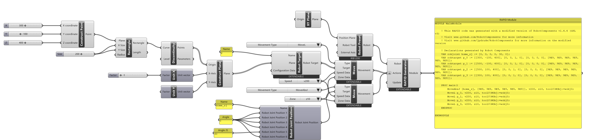
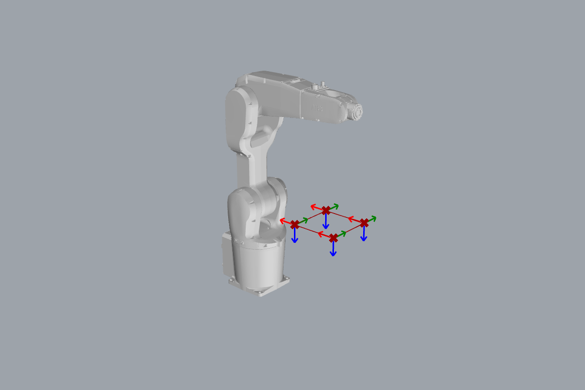

# { .rc-icon--title } Move

<span class="rc-badge">Code Generation tab</span>
<span class="rc-badge rc-badge--verified">RAPID checked on IRB 1200 · RobotWare 6.10</span>

**Move** turns a target into a robot movement. Feed it one target and you get one
movement; feed it a list of targets and you get one movement per target. The list of
movements, in order, *is* your robot program. The [[RAPID Generator]] turns it into code.

## Inputs and outputs

| Input | Nick | Type | Default | Meaning |
|---|---|---|---|---|
| Type | TY | Integer | `0` (MoveAbsJ) | `0` MoveAbsJ · `1` MoveL · `2` MoveJ · `3` MoveC. Use [[Movement Types]]. |
| Target | TA | [[type:Target]] | joint target `[0,0,0,0,0,0]` | Where to go: a [[type:Robot Target]], a [[type:Joint Target]] or a [[type:Robot Joint Position]]. |
| Speed Data | SD | [[type:Speed Data]] or number | `v5` | How fast. A number picks the nearest predefined speed (`200` → `v200`). |
| Zone Data | ZD | [[type:Zone Data]] or number | `z0` | How close the robot must get before moving on. `-1` means `fine` (stop exactly on the point). |

Right-click the component to add optional inputs:

| Menu item | Adds input | Type | Effect |
|---|---|---|---|
| Set Circular Point | Circular Point (CP) | [[type:Robot Target]] | Via-point for **MoveC** (circular arcs). |
| Set Movement Time | Time (TI) | Number | Total time in seconds; overrides the speed. |
| Override Robot Tool | Robot Tool (RT) | [[type:Robot Tool]] | Use another tool for this move only. |
| Override Work Object | Work Object (WO) | [[type:Work Object]] | Use another work object for this move only. |
| Set Digital Output | Digital Output (DO) | from [[Set Digital Output]] | Switch a signal at the target, which turns MoveL/MoveJ into MoveLDO/MoveJDO. |

| Output | Nick | Type | Meaning |
|---|---|---|---|
| Movement | M | [[type:Movement]] | One movement per target, ready for the [[RAPID Generator]] or the [[Path Generator]]. |

!!! info "Which movement type?"
    - **MoveAbsJ**: go to exact joint angles. Use it once at the start of a program to bring the robot to a known pose.
    - **MoveJ**: fastest way between two points; the path in between is curved and not predictable. Use it to get *to* the work area.
    - **MoveL**: the tool tip moves in a straight line. Use it *while working* (drawing, gluing, milling).
    - **MoveC**: the tool tip moves along a circular arc through a via-point.

## Example: drive a square

[:material-download: move-square.gh](../../examples/part-a/move-square.gh){ .md-button download="move-square.gh" }

**Components used**

<div class="rc-used" markdown>
<span>[[Robot Preset]]</span>
<span>[[Robot Target]]</span>
<span>[[Robot Joint Position]]</span>
<span>[[Move]]</span>
<span>[[Movement Types]]</span>
<span>[[Predefined Speed Data]]</span>
<span>[[Predefined Zone Data]]</span>
<span>[[RAPID Generator]]</span>
</div>

Plus Grasshopper basics:
[[gh:XY Plane]] · [[gh:Construct Point]] · [[gh:Rectangle]] · [[gh:Discontinuity]] ·
[[gh:Unit X]] · [[gh:Unit Y]] · [[gh:Construct Plane]] · [[gh:Number Slider]] · [[gh:Panel]]

<div class="rc-canvas" markdown>

</div>

What happens, from left to right:

1. [[gh:Rectangle]] → [[gh:Discontinuity]] gives the four corner points of a 200 × 200 mm square, 400 mm above the robot base.
2. [[gh:Construct Plane]] turns each point into a plane. X axis = −X and Y axis = +Y make the plane's Z axis point **down**, so the tool points at the table.
3. [[Robot Target]] wraps each plane into a [[type:Robot Target]]. It gets the name `p`; with four planes the names become `p_0` … `p_3`.
4. The **upper** [[Move]] makes four `MoveL` movements, one per target. Its type, speed and zone come from [[Movement Types]], [[Predefined Speed Data]] and [[Predefined Zone Data]]. When placed, each of these turns itself into a drop-down list: pick `MoveL`, `v200` and `z10`.
5. The **lower** [[Move]] starts the program with a `MoveAbsJ` to a safe joint pose, a [[type:Robot Joint Position]] from [[Robot Joint Position]] (all joints 0, joint 5 at 30°).
6. [[Robot Preset]] (IRB 1200-5/0.9, picked from the dialog that opens when you place it) and both lists of [[type:Movement|Movements]] go into the [[RAPID Generator]], which writes one module. Its *Actions* input is **flattened** (the small arrow icon); see the gotcha below.



??? example "Generated RAPID (for the curious)"
    ```
    MODULE MainModule
        VAR robjoint home_rj := [0, 0, 0, 0, 30, 0];
        VAR robtarget p_0 := [[300, -100, 400], [0, 0, 1, 0], [0, 0, 0, 0], [9E9, 9E9, 9E9, 9E9, 9E9, 9E9]];
        VAR robtarget p_1 := [[500, -100, 400], [0, 0, 1, 0], [0, 0, 0, 0], [9E9, 9E9, 9E9, 9E9, 9E9, 9E9]];
        VAR robtarget p_2 := [[500, 100, 400], [0, 0, 1, 0], [0, 0, 0, 0], [9E9, 9E9, 9E9, 9E9, 9E9, 9E9]];
        VAR robtarget p_3 := [[300, 100, 400], [0, 0, 1, 0], [0, 0, 0, 0], [9E9, 9E9, 9E9, 9E9, 9E9, 9E9]];

        PROC main()
            MoveAbsJ [home_rj, [9E9, 9E9, 9E9, 9E9, 9E9, 9E9]], v200, z10, tool0\WObj:=wobj0;
            MoveL p_0, v200, z10, tool0\WObj:=wobj0;
            MoveL p_1, v200, z10, tool0\WObj:=wobj0;
            MoveL p_2, v200, z10, tool0\WObj:=wobj0;
            MoveL p_3, v200, z10, tool0\WObj:=wobj0;
        ENDPROC
    ENDMODULE
    ```
    (Header comments removed.) Each Move became one line in `PROC main()`. Each target became
    one `robtarget` declaration at the top: position in mm, orientation as a quaternion,
    axis configuration, and external axes (`9E9` = not used).

    **Checked on a Virtual Controller** (IRB 1200-5/0.9, RobotWare 6.10): loads and runs,
    cycle time **6.2 s**, with one warning that Task 2 below is about.

## Try it

- [ ] **Speed.** Change the [[Predefined Speed Data]] list from `v200` to `v50` and read the generated code. Why did *both* Moves change?
- [ ] **The last point.** The controller reports *50024 Corner path failure* on the last `MoveL`: the program ends while the robot is still told to round off the corner (`z10`). Give the **last** movement the zone `fine` (`-1`) and keep `z10` for the others. *Hint: the Zone Data input takes a list, one value per target.*
- [ ] **Joint vs. linear.** Switch the square's type to `MoveJ`. Preview both with the [[Path Generator]]. Where does the tool tip leave the square's edges?

??? success "Solution to Task 2"
    Replace the `z10` list on the upper [[Move]] with a [[gh:Panel]] containing four lines
    `10`, `10`, `10`, `-1`. Grasshopper matches the four zones to the four targets one by one.
    The last line of RAPID becomes `MoveL p_3, v200, fine, tool0\WObj:=wobj0;`.
    On the Virtual Controller the program now runs with **no warnings** (cycle time 5.7 s).

## In RAPID

You don't need RAPID to use Move. If you want to look up what the generated instructions
do on the controller, ABB documents `MoveAbsJ`, `MoveL`, `MoveJ`, `MoveC`, `MoveLDO`,
`MoveJDO`, and the data types `speeddata`, `zonedata`, `robtarget` and `jointtarget` in the
[RAPID Instructions, Functions and Data types][abb-ifd] manual (3HAC050917-001).

## Gotchas

!!! warning "Two RAPID modules instead of one"
    [[gh:Discontinuity]] outputs its points on branch `{0;0}`, while a [[Move]] fed with a single
    target outputs on `{0}`. The [[RAPID Generator]] makes **one module per branch**. Fix:
    right-click its *Actions* input → **Flatten**.

!!! warning "Type defaults to MoveAbsJ"
    With nothing connected to *Type*, every movement is a `MoveAbsJ`. A [[type:Robot Target]]
    is then converted to a joint target, and the component warns *"An Absolute Joint Movement
    instruction is combined with a Robot Target"*. Always connect [[Movement Types]].

!!! bug "Known issue: Joint Target with a named Robot Joint Position does not load"
    [[Joint Target]] → [[Move]] produces `VAR jointtarget home := [home_rj, …];`. RAPID only
    accepts constant values in a `VAR` declaration, so the controller rejects the module (load
    error at that line). This affects the upstream project too.
    **Workaround:** wire the [[type:Robot Joint Position]] directly into the Move's *Target*, as
    in the example above; it is then written inline in the `MoveAbsJ` line.

## See also

[[Robot Target]] · [[Speed Data]] · [[Zone Data]] · [[Path Generator]] · [[RAPID Generator]]
