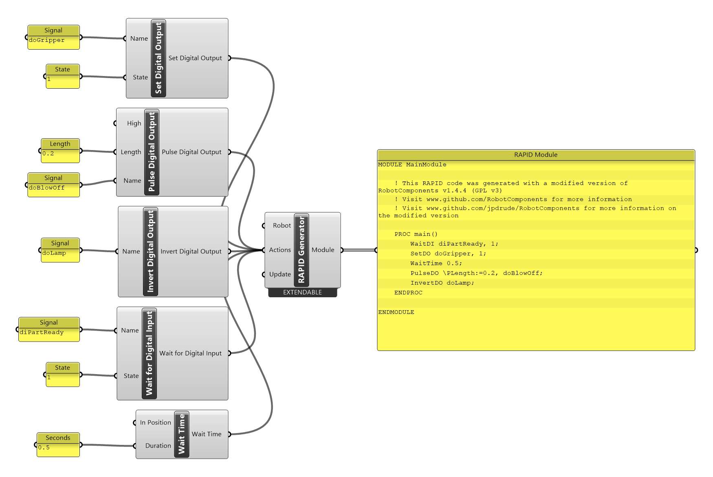

# { .rc-icon--title } Set outputs

<span class="rc-badge">Code Generation tab</span>
<span class="rc-badge rc-badge--verified">RAPID syntax checked on IRB 1200 · RobotWare 6.10</span>

Outputs are how the robot program switches things in the cell: a gripper, a vacuum valve, a
lamp, a spindle. Each output has a **name** configured on the controller (ask whoever set up
the cell, or look in RobotStudio under *I/O System*). These components switch it at that
point in the program:

| Component | Does | RAPID |
|---|---|---|
| [[Set Digital Output]] | sets an on/off output to `1` or `0` | `SetDO doGripper, 1;` |
| [[Pulse Digital Output]] | switches it on for a short time | `PulseDO \PLength:=0.2, doBlowOff;` |
| [[Invert Digital Output]] ★ | flips it: on becomes off, off becomes on | `InvertDO doLamp;` |
| [[Set Analog Output]] | sets a value, e.g. a spindle speed | `SetAO aoSpeed, 5.5;` |
| [[Set Group Output]] ★ | sets several digital outputs at once as one number | `SetGO goProgram, 3;` |

★ <span class="rc-badge rc-badge--fork">Fork addition</span>

## Example: a gripper sequence

[:material-download: io-sequence.gh](../../examples/part-a/io-sequence.gh){ .md-button download="io-sequence.gh" }

<div class="rc-canvas" markdown>

</div>

```
PROC main()
    WaitDI diPartReady, 1;              ! wait until a part is there
    SetDO doGripper, 1;                 ! close the gripper
    WaitTime 0.5;                       ! give it time to close
    PulseDO \PLength:=0.2, doBlowOff;   ! 0.2 s air blast
    InvertDO doLamp;                    ! toggle the lamp
ENDPROC
```

**Syntax checked on a Virtual Controller** (IRB 1200-5/0.9, RobotWare 6.10). The demo
controller has none of these signals, so the check declared them as placeholders
(`VAR signaldi diPartReady;` …). On your robot they come from the I/O configuration, and
**the names must match exactly**. Movements are left out to keep the example short; in a
real program the Moves go between these lines.

## Inputs and outputs

### Set Digital Output
[[io:Set Digital Output]]

### Pulse Digital Output
[[io:Pulse Digital Output]]

### Invert Digital Output
[[io:Invert Digital Output]]

### Set Analog Output
[[io:Set Analog Output]]

### Set Group Output
[[io:Set Group Output]]

ABB's reference: [RAPID Instructions, Functions and Data types][abb-ifd]
([[abb:SetDO]], [[abb:PulseDO]], [[abb:InvertDO]], [[abb:SetAO]], [[abb:SetGO]]).

## Gotchas

!!! warning "Unknown signal names stop the program from loading"
    A signal name the controller doesn't know is an error when the module loads. Check
    the spelling and case against the controller's I/O list.

!!! tip "Switch at the point, not before"
    The output switches when the program reaches the line. With a zone on the Move before it
    (`z10`), the robot may still be moving. Use `fine` on the Move before gripping, or the
    *Set Digital Output* input of [[Move]] (`MoveLDO`) to switch exactly at the target.

!!! info "Component vs. controller utility"
    These components write **program lines**. To switch a signal **right now** from
    Grasshopper, without a program, use [[Set Digital Output (Controller)]] in Controller Utility.

## See also

[[Wait for Digital Input]] · [[Wait Time]] · [[Move]] · [[Connect Interrupt]]
