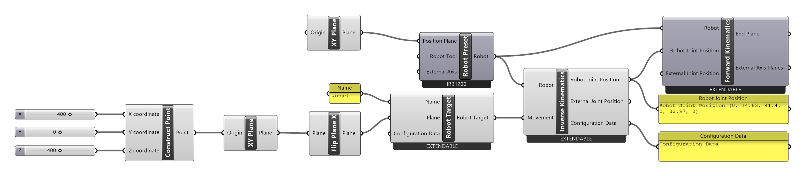
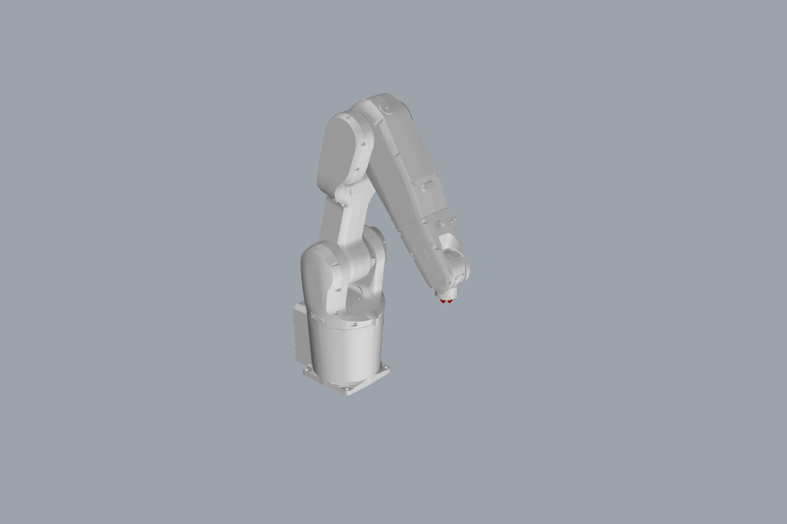

# { .rc-icon--title } Inverse Kinematics

Simulation tab

**Inverse Kinematics** (IK) answers: *which joint angles put the tool on this target?* Give
it a [[type:Robot]] and a [[Move]] (or a [[Robot Target]] directly) and it outputs the six
joint angles and shows the robot in that pose. Use it to check single targets, to find the
right [[Configuration Data]], or to get joint values for a [[Robot Joint Position]].

[[io:Inverse Kinematics]]

Right-click options: *Output Configuration Data* (the configuration of the found pose),
*Output Posed Meshes*, *Output Posed Axis Planes* ★ (the plane of every joint in the pose),
*Preview Posed Meshes* (on/off), and *Closest Robot Joint Position*: choose the solution
closest to the previous one, useful when stepping along a path.

★ Fork addition

## Example

[:material-download: ik-fk.gh](../../examples/part-a/ik-fk.gh){ .md-button download="ik-fk.gh" }

For the target from [Getting started](../../getting-started/index.md), (400, 0, 400), tool
down, IK gives:

| Output | Value |
|---|---|
| Robot Joint Position | `[0, 14.63, 41.4, 0, 33.97, 0]` (degrees) |
| Configuration Data | `[0, 0, 0, 0]` |

Feeding those joint angles into [[Forward Kinematics]] gives back exactly (400, 0, 400)
with Z pointing down. IK and FK are each other's inverse.

## The GoFa (CRB 15000) solver Fork addition

ABB's collaborative GoFa robots (CRB 15000) have an offset wrist, which the standard solver
can't handle. In this fork, IK uses a dedicated solver for them and also detects wrist,
elbow and shoulder **singularities**: poses where the robot loses a degree of freedom and
moves badly.

!!! info "Configuration quadrants that can't be reached"
    IK checks that the target's *cf1*, *cf4* and *cf6* can be reached and warns otherwise, e.g.
    *"cf6 = 1 is not possible for this target (robot joint 6 is at 50.2 degrees, cf6 = 0)"*. A
    quadrant of `0` isn't checked: that's also what you get without [[Configuration Data]], or with
    only a *CFX*. The [[Path Generator]] shows the warning only for the target the *Animation Slider*
    currently points to.

!!! info "Check the whole path, not just targets"
    IK checks one pose. A [[abb:MoveL]] between two reachable targets can still pass through a
    singularity or out of reach. Check the whole program with the [[Path Generator]] or
    [[Check Actions]].

## See also

[[Forward Kinematics]] · [[Configuration Data]] · [[Path Generator]] · [[Check Actions]]
