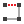
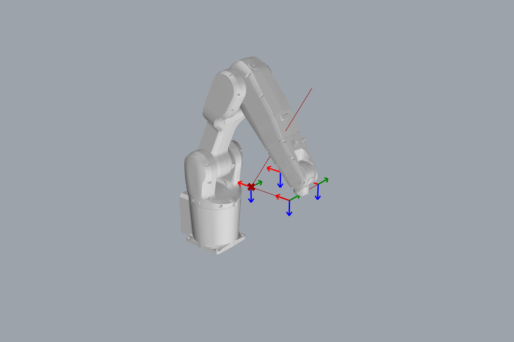

# { .rc-icon--title } Path Generator

Simulation tab

**Path Generator** plays your program in Rhino: it draws the tool path and shows the robot
at any point along it. Wire the same [[type:Robot]] and the same list of actions you give
the [[RAPID Generator]], and drag a slider from 0 (start) to 1 (end).

[[io:Path Generator]]

Right-click to output more: the current [[type:Movement]], the TCP plane, the
[[type:Robot Joint Position]] and [[type:Configuration Data]] at the slider position, all
of them for the whole path, the **program time** (an estimate, in minutes), the **error
messages** collected along the path (unreachable targets, joint limits), and the posed meshes.

## Example

The [[Move]] example with a Path Generator added: *Robot* from [[Robot Preset]], *Actions*
from the same two Moves (flattened), and a [[gh:Number Slider]] from 0 to 1 on
*Animation Slider*.

At slider value `0.62` the robot is at a corner of the square. *Program Time* gives
**0.096 min ≈ 5.8 s**. The same program measured **6.2 s** on the Virtual Controller: close,
but an estimate. The controller's acceleration and corner zones decide the real time.

## What it can and can't tell you

| It shows | It doesn't check |
|---|---|
| whether every target is reachable, and joint-limit problems | **collisions** with your cell, fixtures or the robot itself |
| how [[abb:MoveJ]] and [[abb:MoveL]] paths differ | the exact path inside corner zones |
| roughly how long the program takes | anything that is only known on the controller: [Part B](../../part-b/index.md) variables, `Offs(…, i * 100, …)`, operator input |

!!! tip "Hide the Robot Preset preview"
    [[Robot Preset]] draws its own robot in the home pose. Right-click it → *Preview* off,
    so only the animated robot is visible.

## Try it

- [ ] Switch the square's movement type to `MoveJ` and compare the paths between the corners.
- [ ] Add the *Error Messages* output and push the square out of reach (X slider to 600, Size to 300, so the far corners are at X = 900, about 1 m from the robot base). What does it say?

??? success "Solutions"
    1. With `MoveL` every edge is a straight 200 mm line. With `MoveJ` the tool tip curves away
       from each edge, by about 9–10 mm in the middle (each edge becomes about 201 mm long), and the
       move from the start pose to the first corner bulges by 73 mm. *Program Time* hardly changes
       (0.096 → 0.099 min). That's why `MoveJ` is for getting somewhere, and `MoveL` for working
       along a line.
    2. *"Movement p_1\wobj0: The target is out of reach (elbow singularity)."* and the same for
       `p_2`: the two corners at X = 900 (`p_0` and `p_3`, at X = 600, are still reachable). The
       component also shows them as warnings.

## See also

[[Timed Path Generator]] · [[Inverse Kinematics]] · [[Check Actions]] · [[RAPID Generator]]
