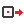

# { .rc-icon--title } Controller poses

Controller Utility tab

These components read the **current** position of a connected robot ([[Get Controller]])
into Grasshopper: as targets, joint angles or planes. Use them to bring a pose you jogged on
the FlexPendant into your definition, to place geometry where the tool is, or to check a cell
against your model.

| Per mechanical unit | Per task |
|---|---|
| [[Get Robot Targets]] · [[Get Joint Targets]] | [[Get Robot Joint Positions]] · [[Get External Joint Positions]] |
| | [[Get Robot Tool Planes]] · [[Get External Axis Planes]] · [[Get Robot Base Frames]] |

### Get Robot Targets
[[io:Get Robot Targets]]

### Get Robot Joint Positions
[[io:Get Robot Joint Positions]]

### Get Robot Tool Planes
[[io:Get Robot Tool Planes]]

??? info "Inputs and outputs of the other pose components"
    #### Get Joint Targets
    [[io:Get Joint Targets]]

    #### Get External Joint Positions
    [[io:Get External Joint Positions]]

    #### Get External Axis Planes
    [[io:Get External Axis Planes]]

    #### Get Robot Base Frames
    [[io:Get Robot Base Frames]]

## See also

[[Get Controller]] · [[Robot Tool Calibration]] · [[Forward Kinematics]]
