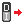

# { .rc-icon--title } Controller signals

Controller Utility tab

These components talk to a **connected** controller ([[Get Controller]]) **right now**: read
the current value of a signal, or switch an output from Grasshopper. No program needed.
Useful for testing a gripper, a lamp or a sensor while setting up a cell.

| Read | Write |
|---|---|
| [[Get Digital Input (Controller)\|Get Digital Input]] · [[Get Digital Output (Controller)\|Get Digital Output]] | [[Set Digital Input (Controller)\|Set Digital Input]] · [[Set Digital Output (Controller)\|Set Digital Output]] |
| [[Get Analog Input (Controller)\|Get Analog Input]] · [[Get Analog Output (Controller)\|Get Analog Output]] | [[Set Analog Input (Controller)\|Set Analog Input]] · [[Set Analog Output (Controller)\|Set Analog Output]] |
| [[Get Group Input (Controller)\|Get Group Input]] ★ · [[Get Group Output (Controller)\|Get Group Output]] ★ | [[Set Group Input (Controller)\|Set Group Input]] ★ · [[Set Group Output (Controller)\|Set Group Output]] ★ |

★ Fork addition

### Get Digital Input
[[io:Get Digital Input (Controller)]]

### Set Digital Output
[[io:Set Digital Output (Controller)]]

The other components work the same way for their signal type. [[Deconstruct Group Signal]]
splits a group signal into its bits.

??? info "Inputs and outputs of the other signal components"
    #### Get Digital Output
    [[io:Get Digital Output (Controller)]]

    #### Set Digital Input
    [[io:Set Digital Input (Controller)]]

    #### Get Analog Input
    [[io:Get Analog Input (Controller)]]

    #### Get Analog Output
    [[io:Get Analog Output (Controller)]]

    #### Set Analog Input
    [[io:Set Analog Input (Controller)]]

    #### Set Analog Output
    [[io:Set Analog Output (Controller)]]

    #### Get Group Input ★
    [[io:Get Group Input (Controller)]]

    #### Get Group Output ★
    [[io:Get Group Output (Controller)]]

    #### Set Group Input ★
    [[io:Set Group Input (Controller)]]

    #### Set Group Output ★
    [[io:Set Group Output (Controller)]]

**In RAPID**, signals are data of the types `signaldi`, `signaldo`, `signalai`, `signalao`,
`signalgi` and `signalgo`; ABB describes them together as [[abb:signalxx]].

!!! warning "Program lines vs. live switching"
    To switch a signal **inside a robot program**, use the Code Generation components on
    [Set outputs](../a4-io-and-timing/set-outputs.md). These live components switch immediately,
    whatever the program is doing. Be careful with outputs that move things.

## See also

[[Get Controller]] · [Set outputs](../a4-io-and-timing/set-outputs.md)
