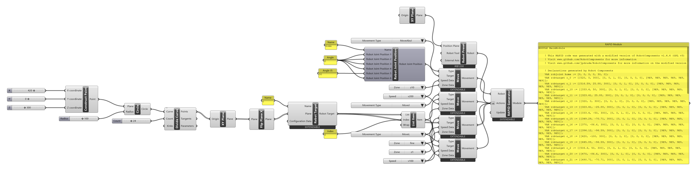
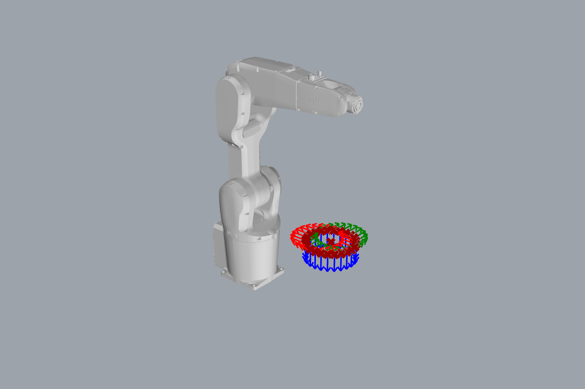

# Tutorial: following a curve

<span class="rc-badge rc-badge--verified">RAPID checked on IRB 1200 · RobotWare 6.10</span>

Drawing, gluing, cutting, dispensing: many robot jobs mean **tracing a curve**. The recipe is
always the same. Divide the curve into points, turn each point into a target, and connect
them with [[abb:MoveL]]. Here the curve is a circle; swap it for any curve from Rhino.

[:material-download: follow-curve.gh](../../examples/part-a/follow-curve.gh){ .md-button download="follow-curve.gh" }

**Components used**

<div class="rc-used" markdown>
<span>[[Robot Preset]]</span>
<span>[[Flip Plane X]]</span>
<span>[[Robot Target]]</span>
<span>[[Robot Joint Position]]</span>
<span>[[Move]]</span>
<span>[[Predefined Speed Data]]</span>
<span>[[Predefined Zone Data]]</span>
<span>[[RAPID Generator]]</span>
</div>

Plus Grasshopper: [[gh:Construct Point]] · [[gh:Circle]] · [[gh:Divide Curve]] · [[gh:List Item]] · [[gh:XY Plane]] · [[gh:Number Slider]] · [[gh:Panel]]

<div class="rc-canvas" markdown>

</div>



## Step by step

1. **The curve.** [[gh:Circle]] with centre (420, 0, 300) and radius 100. Any curve works: reference
   one from Rhino with a [[ghtype:Curve]] parameter instead.
2. **Points.** [[gh:Divide Curve]] with *Count* 24 gives 24 points along it. More points follow
   the curve more closely.
3. **Targets.** Each point → [[gh:XY Plane]] → [[Flip Plane X]] (tool down) →
   [[Robot Target]] named `c`, which gives `c_0` … `c_23`.
4. **Approach.** [[gh:List Item]] with index `0` picks the first target. A [[Move]] goes there
   with [[abb:MoveJ]] and `fine`: get to the start quickly, then stop.
5. **Trace.** One [[Move]] with **all** targets, `MoveL`, `v100`, zone **`z1`**: the robot
   blends through the points without stopping, so the motion is smooth.
6. **Close and stop.** A last `MoveL` back to the first target with `fine`, which closes the
   circle and ends the program at a stop point.
7. **Generate.** All four Moves into the [[RAPID Generator]] (home first), *Actions* flattened.

```
MoveJ c_0, v200, fine, tool0\WObj:=wobj0;
MoveL c_0, v100, z1, tool0\WObj:=wobj0;
MoveL c_1, v100, z1, tool0\WObj:=wobj0;
...
MoveL c_23, v100, z1, tool0\WObj:=wobj0;
MoveL c_0, v100, fine, tool0\WObj:=wobj0;
```

**Checked on a Virtual Controller** (IRB 1200-5/0.9, RobotWare 6.10): runs with no
warnings, cycle time **9.3 s**. `c_0` is used by three Moves but declared only once.

## Why `z1` and not `fine`?

With `fine`, the robot stops at **every** point: 24 stops in one circle, jerky and slow.
With a zone, it rounds each corner by up to 1 mm and keeps moving. For a curve divided
into many points that's what you want. Choose the zone smaller than the spacing between
points (here about 26 mm), or the robot cuts the curve short.

## Try it

- [ ] Replace the circle by a curve you draw in Rhino. Which component do you use to bring it in?
- [ ] Make the robot trace the circle twice. *(Hint: wire the tracing Move into the generator twice.)*
- [ ] Set *Count* to 6. What shape does the robot actually draw, and why?

??? success "Solutions"
    1. A [[ghtype:Curve]] parameter (Params tab): right-click → *Set one Curve* and pick it in Rhino.
       Mind the units: Robot Components works in mm.
    2. Wire the `MoveL` Move into *Actions* a second time, before the closing move. The targets
       are declared only once.
    3. A hexagon: `MoveL` drives straight lines between the 6 points.
