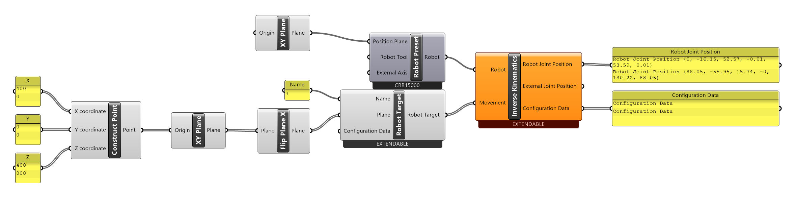
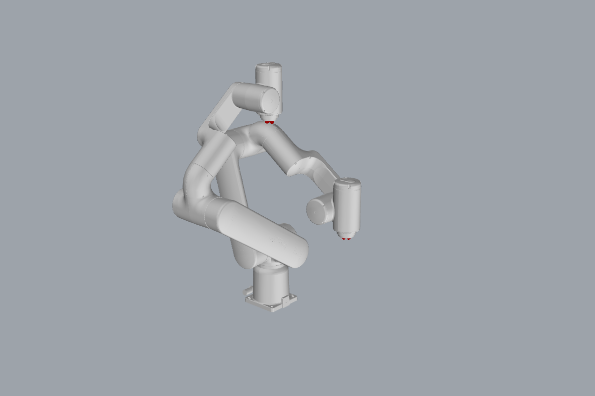

# Tutorial: working with a GoFa

Fork addition

ABB's collaborative **GoFa** robots (CRB 15000) don't have the "spherical wrist" that the
standard Robot Components solver assumes: their wrist axes are offset. This fork adds a
dedicated solver for them, used automatically for every CRB 15000 preset, which also warns
when a target is close to a **singularity**.

[:material-download: gofa-ik.gh](../../examples/part-a/gofa-ik.gh){ .md-button download="gofa-ik.gh" }

[[Robot Preset]]
[[Robot Target]]
[[Inverse Kinematics]]
[[Flip Plane X]]

## Step by step

1. [[Robot Preset]] → pick **CRB15000-5/0.95** (also available: -10/1.52, -12/1.27).
2. Two targets, tool pointing down: (400, 0, 400) in front of the robot and (0, 0, 800)
   straight above its base.
3. [[Inverse Kinematics]] with *Output Configuration Data* (right-click).

## What the solver says

| Target | Robot Joint Position | Configuration | Message |
|---|---|---|---|
| (400, 0, 400) | `[0, -16.15, 52.57, -0.01, 53.59, 0.01]` | `[0, -1, 0, 0]` | — |
| (0, 0, 800) | `[88.05, -55.95, 15.74, 0, 130.22, 88.05]` | `[0, -1, 0, 0]` | *"The robot is near a shoulder singularity."* |

The second target lies on axis 1. Any rotation of axis 1 reaches it, so the solver can't tell
which one you mean (it picked 88°). Near such a **shoulder singularity**, small target
changes make axis 1 spin quickly. The solver checks three cases and warns on the
[[Inverse Kinematics]] component:

| Message | Means |
|---|---|
| *"The robot is near a wrist singularity."* | axes 4 and 6 nearly aligned (joint 5 near 0°) |
| *"The target is out of reach (elbow singularity)."* | arm fully stretched: the target is at or beyond the edge of reach |
| *"The robot is near a shoulder singularity."* | the wrist is (nearly) on axis 1, as here |

Move targets away from them.

!!! info "Not checked on a controller"
    No GoFa Virtual Controller was available for this wiki; these numbers come from the
    Grasshopper solver only. Check GoFa programs in RobotStudio before running them.

!!! warning "Configuration data and issue #19"
    The first target's configuration is `[0, -1, 0, 0]`: joint 4 at −0.01° counts as quadrant
    −1. Copying that into a [[Configuration Data]] component currently turns the `-1` into `0`
    (see the known issue on [[Configuration Data]]). Use the IK output directly instead.

## Try it

- [ ] Move the second target 150 mm forward (X 150). Does the warning disappear?
- [ ] Find a target where the wrist singularity warning appears. *(Hint: joint 5 near 0°: tool axis parallel to the forearm.)*

## See also

[[Inverse Kinematics]] · [[Robot Preset]] · [[Path Generator]] · [[Configuration Data]]
