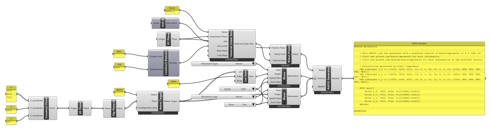
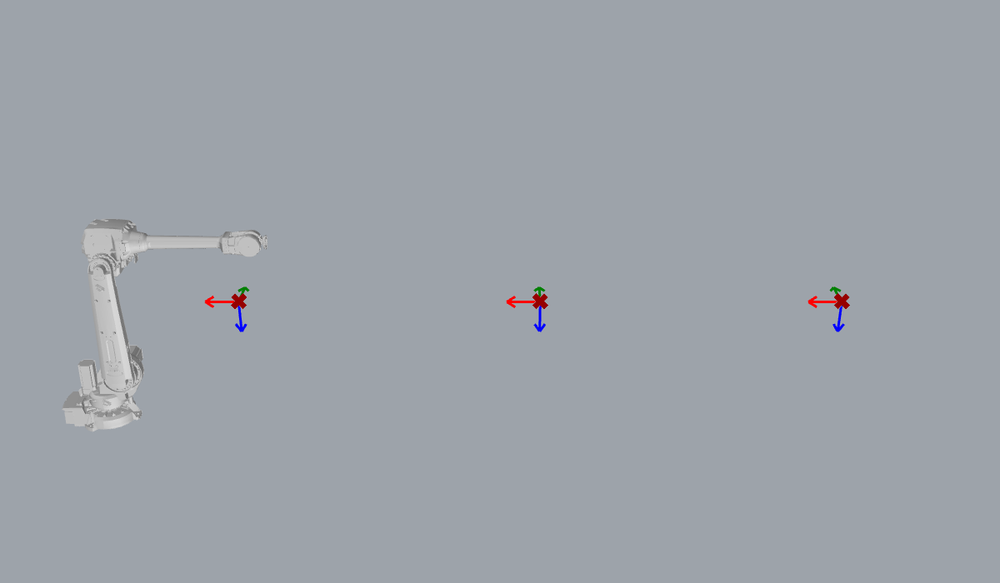

# Tutorial: a robot on a linear track

<span class="rc-badge rc-badge--verified">RAPID checked on IRB 4600 + track · RobotWare 6.16</span>

A robot on a **track** can reach along the whole length of a long part. In Robot
Components the track is an [[External Linear Axis]] carried by the [[Robot Preset]]. When a
[[Move]] goes to a [[Robot Target]], the [[RAPID Generator]] works out where the track must be
and writes it into the target.

[:material-download: linear-track.gh](../../examples/part-a/linear-track.gh){ .md-button download="linear-track.gh" }

**Components used**

<div class="rc-used" markdown>
<span>[[External Linear Axis]]</span>
<span>[[Robot Preset]]</span>
<span>[[Robot Target]]</span>
<span>[[Move]]</span>
<span>[[RAPID Generator]]</span>
</div>

<div class="rc-canvas" markdown>

</div>



## Step by step

1. **The track.** [[External Linear Axis]] named `TRACK_1`. *Attachment Plane* = World XY
   (the robot's position when the track is at 0), *Axis* = [[gh:Unit X]] (it travels along X),
   *Axis Limits* = 0 to 9900 mm (a *Construct Domain*). This matches the controller's track.
2. **The robot.** [[Robot Preset]] *IRB4600-40/2.55*, with the track on its *External Axis* input.
3. **Targets.** Three points at X = 1000, 4000, 7000 (Y 1200, Z 600) → [[gh:XY Plane]] →
   [[Flip Plane X]] → [[Robot Target]] `t`.
4. **Moves.** [[abb:MoveJ]] to the first target, then [[abb:MoveL]] through all three.

## The result

```
VAR robtarget t_0 := [[1000, 1200, 600], [0, 0, 1, 0], [0, 0, 0, 0], [1000, 9E9, 9E9, 9E9, 9E9, 9E9]];
VAR robtarget t_1 := [[4000, 1200, 600], [0, 0, 1, 0], [0, 0, 0, 0], [4000, 9E9, 9E9, 9E9, 9E9, 9E9]];
VAR robtarget t_2 := [[7000, 1200, 600], [0, 0, 1, 0], [0, 0, 0, 0], [7000, 9E9, 9E9, 9E9, 9E9, 9E9]];

PROC main()
    MoveJ t_0, v500, fine, tool0\WObj:=wobj0;
    MoveL t_0, v500, fine, tool0\WObj:=wobj0;
    MoveL t_1, v500, fine, tool0\WObj:=wobj0;
    MoveL t_2, v500, fine, tool0\WObj:=wobj0;
ENDPROC
```

The last block of each robtarget is the track position (`eax_a`): **1000, 4000, 7000**.
Robot Components placed the track level with each target, so the robot always works straight
to its side. A `MoveL` from `t_0` to `t_1` moves the track and the arm **together** so that the
tool travels in a straight line.

**Checked on a Virtual Controller with a track** (IRB 4600-40/2.55 on a 9.9 m track,
RobotWare 6.16): runs with no warnings, cycle time **16.9 s**.

!!! warning "Choose the track position yourself when it matters"
    The automatic position is simple: level with the target. For reach, collisions or cycle
    time you may want the robot elsewhere. Give the [[Robot Target]] an [[External Joint Position]]
    (right-click → *External Joint Position*) with the track value you want.

!!! info "Why no MoveAbsJ home?"
    A safe start pose for a robot with a track needs a joint target including the track
    position, i.e. a [[Joint Target]] with an [[External Joint Position]]. That path currently has a
    [known issue](../a2-targets/joint-target.md#gotchas), so this program starts with a `MoveJ`.

## Try it

- [ ] Put all three targets at the same track position (e.g. 4000) with an [[External Joint Position]]. Which targets can the robot still reach? *(The IRB 4600 reaches 2.55 m.)*

??? success "Solution"
    Only `t_1` (X 4000). `t_0` and `t_2` are 3 m away along X, which is out of reach from a track
    position of 4000 (about 3.3 m from the robot base). Check it with [[Check Actions]] or the [[Path Generator]].
