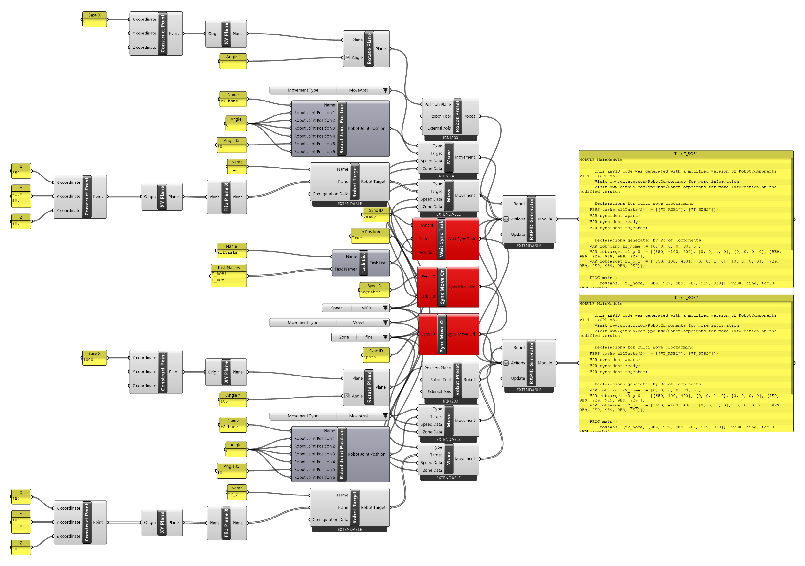
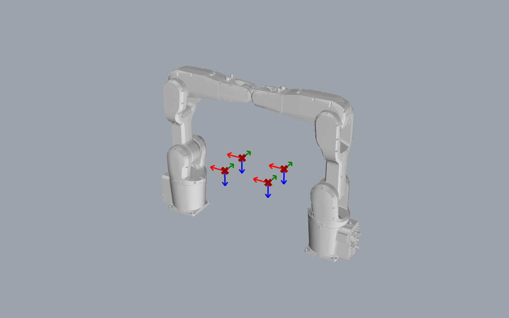

# Tutorial: two robots with Multi Move

!!! warning "Not checked on a controller"
    The RAPID on this page was generated by Robot Components, but **not** run: the demo Virtual
    Controller has a single robot without the MultiMove option and rejects these instructions.
    Test it in a RobotStudio station with two robots before using it.

With ABB's **MultiMove**, one controller drives several robots, each with its own program
(**task**: `T_ROB1`, `T_ROB2`). This tutorial makes two IRB 1200s facing each other meet at a
**sync point**, then move **together** through two targets each.

[:material-download: multi-move.gh](../../examples/part-a/multi-move.gh){ .md-button download="multi-move.gh" }

<div class="rc-used" markdown>
<span>[[Task List]]</span>
<span>[[Wait Sync Task]]</span>
<span>[[Sync Move On]]</span>
<span>[[Sync Move Off]]</span>
<span>[[Robot Preset]]</span>
<span>[[Move]]</span>
<span>[[RAPID Generator]]</span>
</div>

<div class="rc-canvas" markdown>

</div>



## Step by step

1. **Two robots.** Two [[Robot Preset]]s (IRB1200-5/0.9): one at the origin, one at
   X = 1000 turned 180° (*Rotate Plane*, angle in degrees).
2. **One [[Task List]]** `allTasks` with `T_ROB1` and `T_ROB2`, shared by everything below.
3. **Shared sync components:** [[Wait Sync Task]] (`ready`, *In Position* `True`),
   [[Sync Move On]] (`together`) and [[Sync Move Off]] (`apart`).
4. **One [[RAPID Generator]] per robot.** *Actions* in order: home [[abb:MoveAbsJ]], Wait Sync
   Task, Sync Move On, the robot's [[abb:MoveL]] to its two targets, Sync Move Off.

## The generated programs

```
! T_ROB1                                         ! T_ROB2
MoveAbsJ [r1_home, ...], v200, fine, tool0;     MoveAbsJ [r2_home, ...], v200, fine, tool0;
WaitSyncTask \InPos, ready, allTasks;           WaitSyncTask \InPos, ready, allTasks;
SyncMoveOn together, allTasks;                  SyncMoveOn together, allTasks;
MoveL r1_p_0\ID:=10, v200, fine, tool0;         MoveL r2_p_0\ID:=10, v200, fine, tool0;
MoveL r1_p_1\ID:=20, v200, fine, tool0;         MoveL r2_p_1\ID:=20, v200, fine, tool0;
SyncMoveOff apart;                              SyncMoveOff apart;
```

(Shortened: `\WObj:=wobj0` and the declarations are left out.) Both modules also declare
`PERS tasks allTasks{2} := [["T_ROB1"], ["T_ROB2"]];` and the three [[abb:syncident]] declarations.

- [[abb:WaitSyncTask]]: each robot waits here until the other one has arrived too.
- Between [[abb:SyncMoveOn]] and [[abb:SyncMoveOff]], Moves with the same `\ID` start and end
  **together**. The [[RAPID Generator]] numbers them for you (10, 20, …), so both tasks need the
  same number of Moves in that section.

!!! warning "Robot positions must match the controller"
    The targets are written in **world** coordinates (`r2_p_0 := [[650, 100, 400], …]`). They only
    land where you expect if the controller's base frames for both robots match the position
    planes of the two Robot Presets.

!!! danger "Collisions"
    In the zero pose the two robots' arms almost touch (see the viewport). The simulation in
    Grasshopper checks neither collisions between the robots nor with the cell. Check in
    RobotStudio.

## Known issue

The three sync components show an error badge (*"After Solution exception"*) on every solve.
The generated RAPID is correct, but duplicate Sync IDs aren't detected; see [[Wait Sync Task]].

## See also

[[Task List]] · [[Wait Sync Task]] · [[Sync Move On]] · [[Sync Move Off]]
