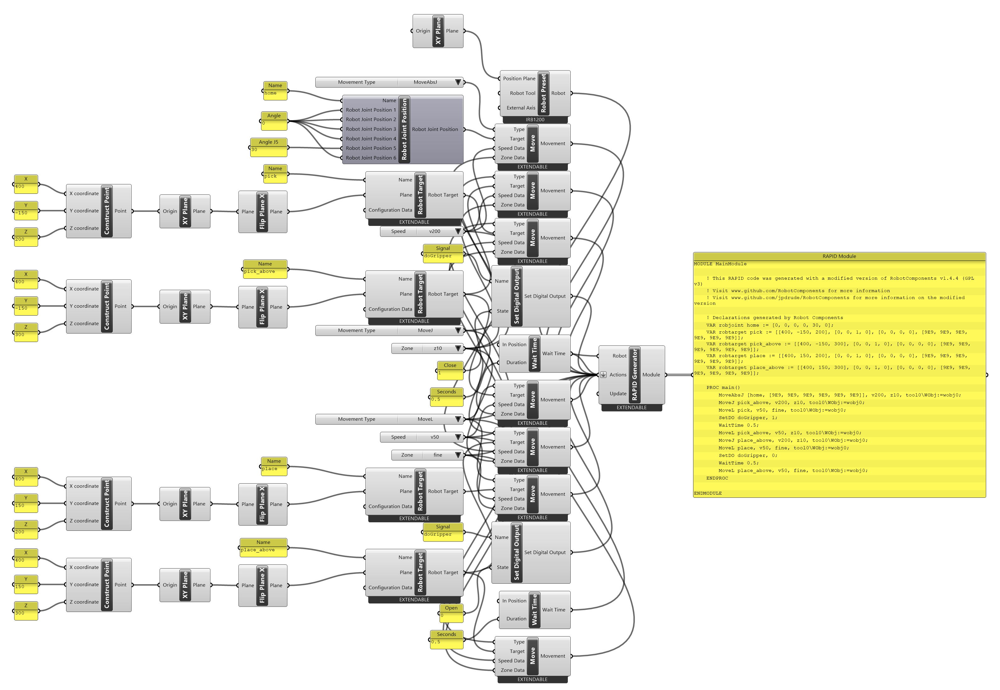
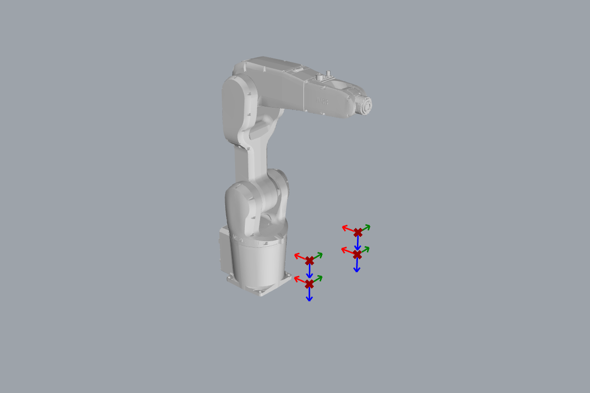

# Tutorial: pick and place

<span class="rc-badge rc-badge--verified">RAPID checked on IRB 1200 · RobotWare 6.10</span>

The classic robot job: take a part from one place and put it down in another. It brings
together most of Part A: targets above and at the part, fast joint moves in free space,
slow linear moves near the part, `fine` where precision matters, and a gripper switched with
a digital output.

[:material-download: pick-and-place.gh](../../examples/part-a/pick-and-place.gh){ .md-button download="pick-and-place.gh" }

**Components used**

<div class="rc-used" markdown>
<span>[[Robot Preset]]</span>
<span>[[Robot Target]]</span>
<span>[[Flip Plane X]]</span>
<span>[[Move]]</span>
<span>[[Set Digital Output]]</span>
<span>[[Wait Time]]</span>
<span>[[RAPID Generator]]</span>
</div>

<div class="rc-canvas" markdown>

</div>



## The program

```
MoveAbsJ [home, [9E9, 9E9, 9E9, 9E9, 9E9, 9E9]], v200, z10, tool0\WObj:=wobj0;
MoveJ pick_above, v200, z10, tool0\WObj:=wobj0;     ! (1) fast to above the part
MoveL pick, v50, fine, tool0\WObj:=wobj0;           ! (2) slowly down, stop exactly
SetDO doGripper, 1;                                 ! (3) close the gripper
WaitTime 0.5;                                       !     give it time
MoveL pick_above, v50, z10, tool0\WObj:=wobj0;      ! (4) straight up
MoveJ place_above, v200, z10, tool0\WObj:=wobj0;    ! (5) fast across
MoveL place, v50, fine, tool0\WObj:=wobj0;          ! (2) slowly down, stop exactly
SetDO doGripper, 0;                                 ! (3) open the gripper
WaitTime 0.5;
MoveL place_above, v50, fine, tool0\WObj:=wobj0;    ! (4) straight up, end on fine
```

**Checked on a Virtual Controller** (IRB 1200-5/0.9, RobotWare 6.10). The full module loads
with `doGripper` declared as a placeholder. The movements, with the two `SetDO` lines left
out because the demo controller has no gripper signal, run with no warnings in **13.7 s**. On
your robot, use the real name of the gripper output.

1. **`MoveJ` to the point above**: in free space the path doesn't matter, so take the fastest one.
2. **`MoveL` down at `v50` with `fine`**: straight and slow near the part, and stop *exactly*
   on it before gripping.
3. **[[Set Digital Output]] + [[Wait Time]]**: switch the gripper, then wait until it has
   actually closed or opened.
4. **`MoveL` straight up**: never drag the part sideways out of its fixture.
5. The "above" targets get `z10`: the robot doesn't need to stop there.

The four targets are built the same way: a point → [[gh:XY Plane]] → [[Flip Plane X]] →
[[Robot Target]]. The "above" points are the same points 100 mm higher.

## Try it

- [ ] Pick from 50 mm higher (Z 250) without touching the "above" targets. Is 100 mm above still enough?
- [ ] Make the trip across faster but the moves near the part even slower.
- [ ] Turn this into a loop over several parts. *(That needs Part B: see the [row tutorial](../../part-b/b8-tutorials/row-loop.md) and [[Offset Target]].)*

??? success "Solutions"
    1. Change the *Z* panel of `pick` to `250`; `pick_above` stays at 300, so the approach is now
       only 50 mm. Raise `pick_above` too if the gripper needs more clearance.
    2. Give the two `MoveJ` Moves their own speed list (e.g. `v500`) and the four `MoveL` Moves `v20`.
