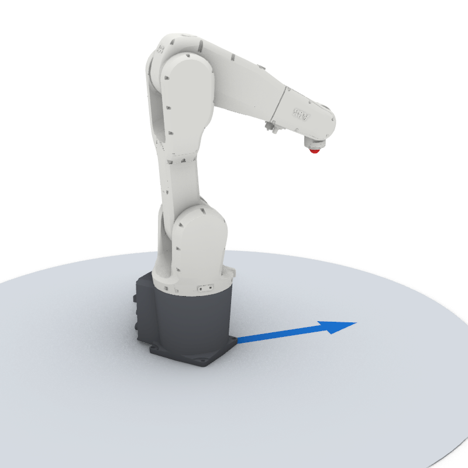
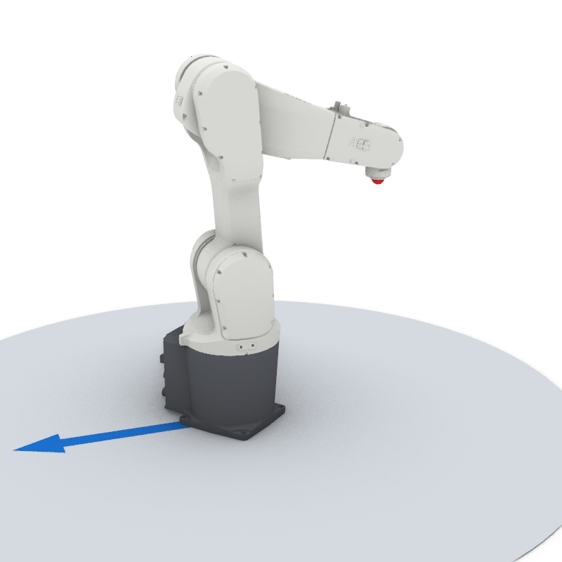
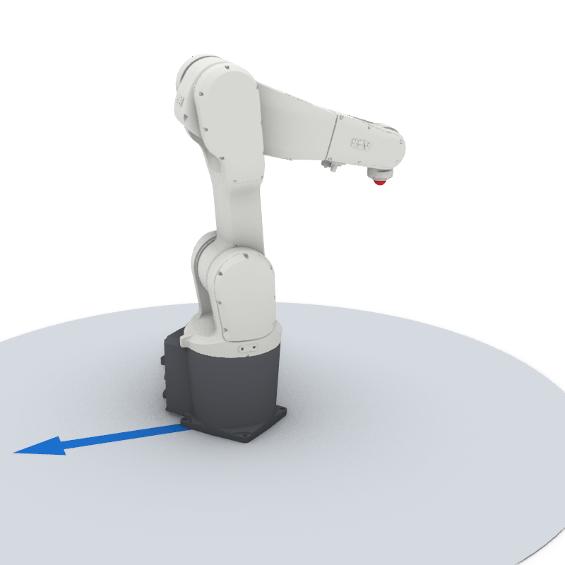
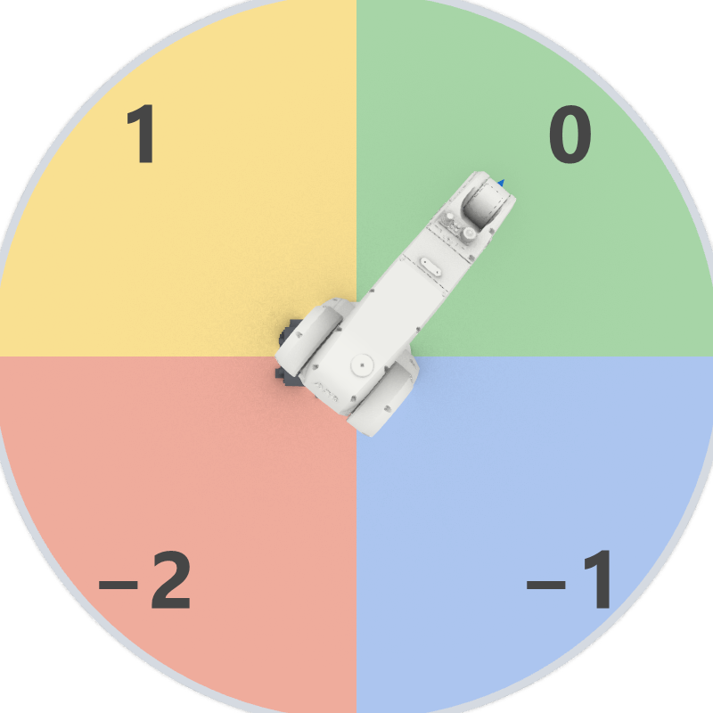
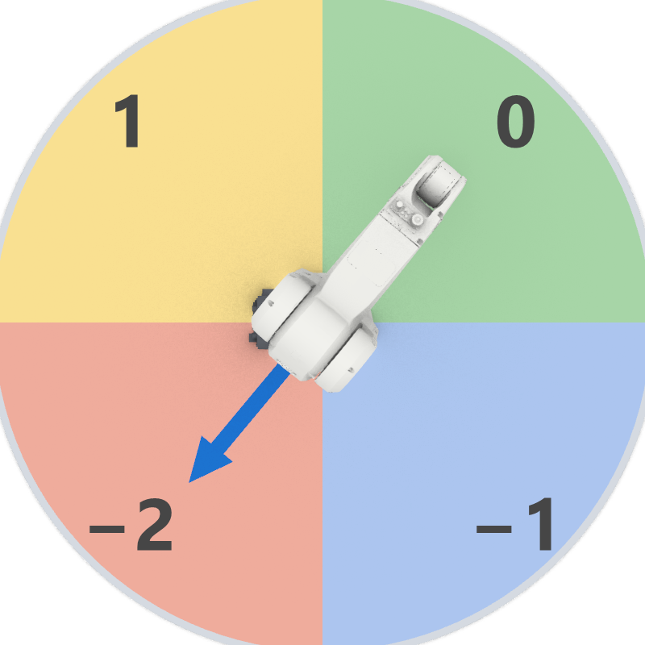

# B0 RAPID primer

**RAPID** is the programming language of ABB robot controllers. In Part A you never had to
read it. Part B's components write real RAPID logic, so this page gives you the
vocabulary: how a program is built, what data looks like, and how to read a generated
module. Everything here is checked on a Virtual Controller.

For the complete language rules, see ABB's [RAPID kernel][abb-kernel] and
[RAPID overview][abb-overview] manuals.

## A program has three levels

| Level | What it is | In Robot Components |
|---|---|---|
| **Task** | One program running on the controller, usually one per robot (`T_ROB1`). | One [[RAPID Generator]] per task; several in [Multi Move](../part-a/a7-multi-move/index.md). |
| **Module** | A file of code inside a task: `MODULE … ENDMODULE`. A task can load several. | The *Module* output of the [[RAPID Generator]] (default name `MainModule`). |
| **Routine** | A named block of instructions inside a module. | `PROC main()` from your actions; more with [[Routine]]. |

There are three kinds of routines:

- **`PROC`**, a procedure: does something, returns nothing. `main` is the one the controller starts.
- **`FUNC`**, a function: computes and **returns** a value (like `Offs(...)` below).
- **`TRAP`**, an interrupt routine: runs when a signal changes. See [[Connect Interrupt]].

## Reading a module line by line

This is the module from [Getting started](../getting-started/index.md):

```
MODULE MainModule                                              ! (1)
    VAR robjoint home := [0, 0, 0, 0, 30, 0];                  ! (2)
    VAR robtarget target := [[400, 0, 400], [0, 0, 1, 0],
                             [0, 0, 0, 0], [9E9, 9E9, 9E9, 9E9, 9E9, 9E9]];

    PROC main()                                                ! (3)
        MoveAbsJ [home, [9E9, 9E9, 9E9, 9E9, 9E9, 9E9]], v200, z10, tool0\WObj:=wobj0;   ! (4)
        MoveJ target, v200, fine, tool0\WObj:=wobj0;
    ENDPROC
ENDMODULE
```

1. Everything lives inside `MODULE <name> … ENDMODULE`. A `!` starts a comment.
2. **Declarations** first: `VAR <type> <name> := <value>;`. Here a set of joint angles
   (`robjoint`) and a position (`robtarget`). Values in `[ … ]` are *aggregates*: one value
   made of several parts.
3. `PROC main()` … `ENDPROC`: the routine with the instructions.
4. An **instruction** with its **arguments**, separated by commas, ending in `;`. Arguments
   starting with `\` are *optional*: `\WObj:=wobj0` means "measured in work object
   `wobj0`". `tool0` and `wobj0` are built in: the bare flange and the robot base.

## Data: three kinds of storage

| Keyword | Meaning | Typical use |
|---|---|---|
| `CONST` | A fixed value; cannot change while the program runs. | Distances, sizes, fixed poses |
| `VAR` | A variable. Gets its declared value again when the module is loaded or the program pointer is reset to `main` (*PP to Main*). | Counters within one run, flags, intermediate results |
| `PERS` | Persistent. Changes are **kept**: written back into the module and remembered between runs. | Part counters, calibrated positions |

ABB's reference: [[abb-kernel:Variable declarations|variable]], [[abb-kernel:Persistent declarations|persistent]] and [[abb-kernel:Constant declarations|constant]] declarations.

!!! warning "Initial values must be constants"
    The value after `:=` in a declaration must be a **literal or a `CONST`**, never another
    `VAR`. `VAR jointtarget j := [home, …];` (where `home` is a `VAR`) is rejected
    when the module loads. That is exactly the [known Joint Target issue](../part-a/a2-targets/joint-target.md#gotchas).

### Scope: who can see it

| Scope | Visible in | Robot Components |
|---|---|---|
| global (default) | The whole task: every module, every routine. | `GLOBAL` |
| `LOCAL` | Only the module it is declared in. | `LOCAL` |
| `TASK` | `PERS` only: the whole task, but **not shared** with other tasks. (A global `PERS` with the same name in two tasks is one shared value.) | `TASK` |

Data declared *inside* a routine exists only while that routine runs. Pick the scope with
[[Predefined Scopes]] on [[Routine]], [[RAPID Variable]] and the [[RAPID Generator]].

## The data types you'll meet

| Type | Holds | Example |
|---|---|---|
| [[abb:num]] | a number (integer or decimal) | `42`, `3.5` |
| [[abb:bool]] | `TRUE` or `FALSE` | `TRUE` |
| [[abb:string]] | text, up to 80 characters | `"hello"` |
| [[abb:robjoint]] | the 6 robot joint angles, degrees | `[0, 0, 0, 0, 30, 0]` |
| [[abb:jointtarget]] | robot joints + external axes | `[[0,0,0,0,30,0], [9E9,9E9,9E9,9E9,9E9,9E9]]` |
| [[abb:robtarget]] | a TCP position: **trans**lation (mm), **rot**ation (quaternion), **robconf** (axis configuration), **extax** (external axes) | `[[400,0,400], [0,0,1,0], [0,0,0,0], [9E9,…]]` |
| [[abb:speeddata]] | TCP mm/s, orientation °/s, external linear mm/s, external rotational °/s | `v200` = `[200, 500, 5000, 1000]` |
| [[abb:zonedata]] | how close to pass a point; `fine` = stop exactly | `z10`, `fine` |
| [[abb:tooldata]] / [[abb:wobjdata]] / [[abb:loaddata]] | tool, work object, payload | `tool0`, `wobj0`, `load0` |

`9E9` (9 × 10⁹) means *"not used"*, e.g. for external axes the robot doesn't have.

The rotation `[0, 0, 1, 0]` is a quaternion (`q1` = w, then x, y, z): a 180° turn about
Y, so the tool's Z axis points straight down. Robot Components works these out from your
planes; you never type them.

## Arm configuration: `confdata`

A robtarget only says where the tool should be. A six-axis arm can usually put its tool
there in several ways, and its axes 1, 4 and 6 can often turn past ±180°. The third block of
the robtarget, `robconf` (type [[abb:confdata]]), says which way is meant:

```
VAR robtarget p := [[250, 300, 600], [0, 0, 1, 0], [0, 1, -2, 1], [9E9, ...]];
                                                    cf1 cf4 cf6 cfx
```

The four numbers answer two **different** questions:

| | Answers | Values |
|---|---|---|
| `cfx` | **Which posture** of the arm: shoulder, elbow, wrist | 0 … 7 |
| `cf1`, `cf4`, `cf6` | **Which turn** of axes 1, 4 and 6: the 90° quadrant each one is in | …, −2, −1, 0, 1, 2, … |

They don't depend on each other. You can't work out one from the other.

### `cfx`: the posture

`cfx` is a three-bit number. Each bit is one yes/no choice:

| Bit | Adds | Set when | Robot Components input |
|---|---|---|---|
| 2 | 4 | the wrist center is **behind axis 1** (the arm reaches back over itself) | *Shoulder* |
| 1 | 2 | the wrist center is **behind the lower arm** | *Elbow* |
| 0 | 1 | **axis 5 is negative** (the wrist is flipped) | *Wrist* |

All four robots below have their tool at the same red point, pointing straight down, with
the same robtarget position and orientation. Only `cfx` differs. The blue arrow shows where
axis 1 faces. (IRB 1200-5/0.9; each pose's `confdata` read back from the Virtual Controller
with `CRobT`.)

<div class="rc-grid" markdown>
<figure markdown>

<figcaption><code>cfx = 0</code>: shoulder forward, wrist normal. <code>robconf [0, 0, 0, 0]</code></figcaption>
</figure>
<figure markdown>

<figcaption><code>cfx = 1</code>: same arm, wrist flipped (axis 4 at 180°, axis 5 negative). <code>robconf [0, 1, -2, 1]</code></figcaption>
</figure>
<figure markdown>

<figcaption><code>cfx = 6</code>: base turned away (arrow), reaching back over itself. <code>robconf [-2, 2, 0, 6]</code></figcaption>
</figure>
<figure markdown>

<figcaption><code>cfx = 7</code>: as 6, wrist flipped. <code>robconf [-2, 0, -2, 7]</code></figcaption>
</figure>
</div>

For this target the other four postures (2 to 5) are outside the IRB 1200's joint limits.
Build `cfx` from the three choices with [[Configuration Number]].

### `cf1`, `cf4`, `cf6`: the quadrants

Each of these is the quadrant its axis is in: `floor(angle / 90)`. `0` is 0…90°, `1` is
90…180°, `-1` is −90…0°, `-2` is −180…−90°, and so on. Negative values are normal. Seen from
above, axis 1's quadrants look like this:

<div class="rc-grid" markdown>
<figure markdown>

<figcaption><code>cfx = 0</code>: axis 1 at 50.2°, so <code>cf1 = 0</code>.</figcaption>
</figure>
<figure markdown>

<figcaption><code>cfx = 6</code>: same target, axis 1 at −129.8°, so <code>cf1 = -2</code>.</figcaption>
</figure>
</div>

The quadrants matter most for axes 4 and 6, which can turn more than a full circle. The
IRB 1200's axis 6 goes from −400° to +400°, so the `cfx = 0` pose above also works with
axis 6 at **−309.8°** instead of +50.2°. The robot looks exactly the same, and only `cf6`
tells the two apart:

| Axis 6 | `robconf` (read back on the Virtual Controller) |
|---|---|
| +50.2° | `[0, 0, 0, 0]` |
| −309.8° | `[0, 0, -4, 0]` |

With configuration control on (the default, [[abb:ConfJ]]/[[abb:ConfL]] `\On`), the
controller moves to the quadrants that are written. If they're wrong, here's what happened on
the Virtual Controller, starting with axis 6 at −309.8°:

- `MoveJ` to the target with `cf6 = -4` (right): axis 6 stays at −309.8°.
- `MoveJ` with `cf6 = 0`: axis 6 **turns a full revolution** to +50.2°. That pulls any
  cable or hose on the tool around with it.
- `MoveL` with `cf6 = 0`: the program stops with **50442 "Robot axis configuration error"**.

!!! tip "Where the values come from"
    You rarely type `confdata` by hand. [[Inverse Kinematics]] returns it together with the
    joint angles, and the [[Path Generator]] outputs it along a path. To write one yourself,
    use [[Configuration Data]] with [[Configuration Number]] for `cfx`. An axis at exactly 0°
    often reads back as `-1` because the controller stops a hair below zero, so a `-1` there
    isn't a mistake.

ABB's reference: [[abb:confdata]], [[abb:ConfJ]], [[abb:ConfL]].

## Expressions, assignments and functions

Part B's components write lines like these:

```
CONST num approach := 50;
PERS num partCount := 0;

    partCount := partCount + 1;                              ! assignment
    MoveJ Offs(pick, 0, 0, approach), v200, z10, tool0;      ! a function as an argument
    TPWrite "Parts picked: " \Num:=partCount;                ! text on the FlexPendant
```

- `:=` **assigns** a new value. (`=` alone *compares*: `IF a = 5 THEN`.)
- `Offs(pick, 0, 0, approach)` is a **function call**: it returns a new robtarget,
  `approach` mm above `pick`, without changing `pick`. See [[Offset Target]].
- Comparisons: `=`, `<>`, `<`, `>`, `<=`, `>=`; logic: [[abb:AND]], [[abb:OR]], [[abb:NOT]]. See
  [[Comparison Expression]].

??? example "Complete module (checked on a Virtual Controller)"
    ```
    MODULE PrimerDemo
        ! Data: a constant, a persistent and two variables
        CONST num approach := 50;
        PERS num partCount := 0;
        VAR bool gripperClosed := FALSE;
        VAR robtarget pick := [[400, 0, 400], [0, 0, 1, 0], [0, 0, 0, 0], [9E9, 9E9, 9E9, 9E9, 9E9, 9E9]];

        PROC main()
            MoveAbsJ [[0, 0, 0, 0, 30, 0], [9E9, 9E9, 9E9, 9E9, 9E9, 9E9]], v200, z10, tool0\WObj:=wobj0;
            MoveJ Offs(pick, 0, 0, approach), v200, z10, tool0\WObj:=wobj0;
            MoveL pick, v50, fine, tool0\WObj:=wobj0;
            gripperClosed := TRUE;
            partCount := partCount + 1;
            TPWrite "Parts picked: " \Num:=partCount;
            MoveL Offs(pick, 0, 0, approach), v200, fine, tool0\WObj:=wobj0;
        ENDPROC
    ENDMODULE
    ```
    **Checked on a Virtual Controller** (IRB 1200-5/0.9, RobotWare 6.10): runs with no
    warnings, cycle time **3.8 s**.

## Try it

- [ ] In the complete module above, which line would fail to load if `approach` were declared `VAR` instead of `CONST`? *(Trick question; read the warning box again.)*
- [ ] `partCount` is `PERS`. You run the program three times, each time after *PP to Main*. What is its value now? What would it be if it were `VAR`?
- [ ] Write the declaration of a `robtarget` named `place` 200 mm to the left of `pick` (−Y), same orientation.

??? success "Solutions"
    1. None. `approach` is only *used* inside `main`, never in another declaration's
       initial value, so `VAR` would also load. The rule only applies to values after `:=` in
       declarations.
    2. `3` as `PERS` (the value is kept between runs); `1` as `VAR` (*PP to Main* resets it
       to its declared `0` before each run).
    3. `VAR robtarget place := [[400, -200, 400], [0, 0, 1, 0], [0, 0, 0, 0], [9E9, 9E9, 9E9, 9E9, 9E9, 9E9]];`

## Next

[B1 Routines](b1-routines/index.md): write your own `PROC`, `FUNC` and `TRAP` with [[Routine]].
