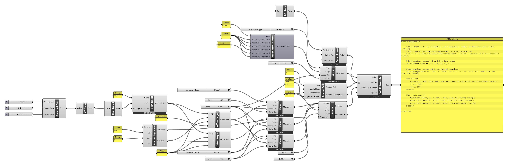

# { .rc-icon--title } Routine

<span class="rc-badge">Advanced RAPID Features tab</span>
<span class="rc-badge rc-badge--fork">Fork addition</span>
<span class="rc-badge rc-badge--verified">RAPID checked on IRB 1200 · RobotWare 6.10</span>

**Routine** packs a list of actions into a named block of RAPID, a routine, that you can
run as often as you like with one line. With arguments, the same routine can do the same job
at different places: write "approach, touch, retract" once and call it for every part.

[[io:Routine]]

When placed, it creates drop-downs for *Type* ([[Routine Types]]: `PROC`, `FUNC`, `TRAP`) and
*Scope* ([[Predefined Scopes]]). Click **+** below *Scope* to add arguments, each fed by a
[[Routine Argument]]. A `FUNC` gets an extra *Return Type* input; it ends with [[Return]].

Two steps make a routine part of the program:

1. Its **Routine** output goes into the [[RAPID Generator]]'s **Additional Routines** input
   (right-click the generator → *Add Additional Routines*). This writes the routine itself.
2. A **call** goes into *Actions*, wherever it should run: its own *Routine Call* output, or a
   [[Routine Call]] component (needed when you call it with different argument values).

## Example: one routine, two places

[:material-download: visit-routine.gh](../../examples/part-b/visit-routine.gh){ .md-button download="visit-routine.gh" }

<div class="rc-used" markdown>
<span>[[Routine]]</span>
<span>[[Routine Argument]]</span>
<span>[[Routine Call]]</span>
<span>[[Offset Target]]</span>
<span>[[Move]]</span>
<span>[[RAPID Generator]]</span>
</div>

<div class="rc-canvas" markdown>

</div>

```
PROC main()
    MoveAbsJ [home, [9E9, 9E9, 9E9, 9E9, 9E9, 9E9]], v200, z10, tool0\WObj:=wobj0;
    visit -150;                                            ! (3)
    visit 150;
ENDPROC

PROC visit(num y)                                          ! (1)
    MoveJ Offs(base, 0, y, 100), v200, z10, tool0\WObj:=wobj0;   ! (2)
    MoveL Offs(base, 0, y, 0), v200, fine, tool0\WObj:=wobj0;
    MoveL Offs(base, 0, y, 100), v200, fine, tool0\WObj:=wobj0;
ENDPROC
```

**Checked on a Virtual Controller** (IRB 1200-5/0.9, RobotWare 6.10): runs with no
warnings, cycle time **6.5 s**. (Declarations and header comments not shown.)

1. [[Routine]]: Type `PROC`, Name `visit`, one argument from a [[Routine Argument]]
   (Type [[abb:num]], Name `y`, **no Value**). That writes `PROC visit(num y)`.
2. The body: three [[Move]]s to [[Offset Target]]s of `base`, whose *Y* is the argument's
   **Variable** output. Inside the routine, `y` is whatever the caller passed.
3. A [[Routine Call]] (Type `0` = PROC, Routine Name `visit`, Argument Value 1 = a
   [[gh:Panel]] with `-150` and `150`) gives one call per value. The calls go into the
   generator's *Actions* after the home move; *Actions* is flattened.

The target `base` is declared automatically because a Move in the routine uses it
(*"Declarations generated in Additional Routines"*).

## In RAPID

| Type | Is | Called as |
|---|---|---|
| `PROC` | a procedure: does something | `visit 150;` (no brackets) |
| `FUNC` | a function: computes and returns a value with `RETURN` | `x := area(10, 20);` (inside an expression) |
| `TRAP` | an interrupt routine, no arguments | never called directly; [[Connect Interrupt]] links it to a signal |

ABB's reference: [RAPID kernel][abb-kernel] ([[abb-kernel:Routine declarations|routine declarations]], [[abb-kernel:Trap declarations|trap declarations]]) and
[RAPID Instructions, Functions and Data types][abb-ifd] ([[abb:RETURN]], [[abb:CONNECT]]).

## Try it

- [ ] Call `visit` a third time, at `y = 0`.
- [ ] Make the approach height an argument too: add a second argument `h` and use it for *Z* of the upper Offset Target.

??? success "Solutions"
    1. Add `0` as a third line to the panel on *Argument Value 1* → `visit 0;`.
    2. Click **+** on the Routine again; a second [[Routine Argument]] (`num`, `h`) gives
       `PROC visit(num y, num h)`. On the [[Routine Call]] click **+** for *Argument Value 2*.

## Gotchas

!!! warning "Several calls: use Routine Call"
    The Routine's own *Routine Call* output makes one call, with the arguments' *Value*. A list
    on a Routine Argument's *Value* uses only the first value (with a warning). For several
    calls, wire the values into a [[Routine Call]].

!!! info "Robot Targets as values"
    A Robot Target (or Joint Target, joint position, Configuration Data) on the argument's *Value* or a [[Routine Call]]'s *Argument Value* is written
    as its value, e.g. `visit [[400, -100, 300], [0, 0, 1, 0], [0, 0, 0, 0], [9E9, …]];`, so
    it needs no declaration. An `INOUT` or `PERS` parameter needs a variable instead: pass a
    [[RAPID Variable]].

!!! info "Routines and the Path Generator"
    Movements inside a routine whose targets depend on arguments only exist on the
    controller, so they can't be previewed in Grasshopper.

## See also

[[Routine Argument]] · [[Routine Call]] · [[Return]] · [[Connect Interrupt]] · [B0 RAPID primer](../b0-rapid-primer.md)
