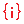

# { .rc-icon--title } Get Array At Index

<span class="rc-badge">Advanced RAPID Features tab</span>
<span class="rc-badge rc-badge--fork">Fork addition</span>
<span class="rc-badge rc-badge--verified">RAPID checked on IRB 1200 · RobotWare 6.10</span>

**Get Array At Index** reads one element of an array [[RAPID Variable]] (one made with
right-click → *Set Array Size*). The index can be a number, or, much more useful, a loop
counter, so a [[For Loop]] can walk through the array.

[[io:Get Array At Index]]

## In RAPID

```
VAR num ys{4} := [0, 50, 150, 300];
...
MoveL Offs(base, 0, ys{k}, 0), v200, fine, tool0\WObj:=wobj0;
```

`ys{k}` is element number `k`. RAPID arrays are **1-based**: `ys{1}` is the first element
(`0`), `ys{4}` the last (`300`). `ys{0}` or `ys{5}` stop the program with error 40204,
*"Array index 5 for dimension number 1 out of bounds (1-4)"* (checked on a Virtual
Controller). ABB's
reference: [RAPID kernel][abb-kernel] ([[abb-kernel:Arrays|arrays]], [[abb-kernel:Declaring array variables|declaring array variables]]).

Full example: [Tutorial: looping over an array](../b8-tutorials/array-offsets.md).

## See also

[[RAPID Variable]] · [[For Loop]] · [[Assign Variable Value]] (right-click for array assignment)
