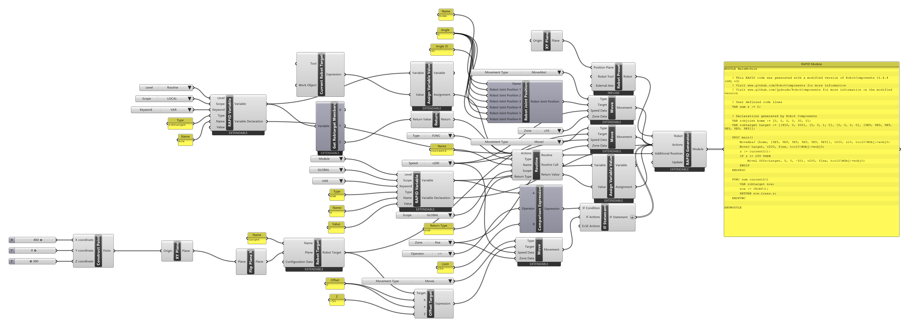

# { .rc-icon--title } Current Robot Target

<span class="rc-badge">Advanced RAPID Features tab</span>
<span class="rc-badge rc-badge--fork">Fork addition</span>
<span class="rc-badge rc-badge--verified">RAPID checked on IRB 1200 · RobotWare 6.10</span>

**Current Robot Target** gives the robot's position **at the moment that line runs** on
the controller, as a robtarget. Store it in a [[RAPID Variable]] with
[[Assign Variable Value]], then take it apart with [[Get Robtarget Members]] or shift it with
[[Offset Target]]: "go 50 mm up from wherever you are now".

[[io:Current Robot Target]]

Without *Tool* and *Work Object* it reports the position of the active tool in the active
work object, usually what you want.

## Example: a function that returns the current height

[:material-download: current-z-func.gh](../../examples/part-b/current-z-func.gh){ .md-button download="current-z-func.gh" }

<div class="rc-used" markdown>
<span>[[Current Robot Target]]</span>
<span>[[Get Robtarget Members]]</span>
<span>[[Return]]</span>
<span>[[Routine]]</span>
<span>[[RAPID Variable]]</span>
<span>[[Assign Variable Value]]</span>
<span>[[Comparison Expression]]</span>
<span>[[IF Statement]]</span>
<span>[[Offset Target]]</span>
</div>

<div class="rc-canvas" markdown>

</div>

```
VAR num z := 0;

PROC main()
    MoveAbsJ [home, [9E9, 9E9, 9E9, 9E9, 9E9, 9E9]], v200, z10, tool0\WObj:=wobj0;
    MoveJ target, v200, fine, tool0\WObj:=wobj0;
    z := currentZ();                                    ! (4)
    IF z >= 299 THEN                                    ! (5)
        MoveL Offs(target, 0, 0, -50), v200, fine, tool0\WObj:=wobj0;
    ENDIF
ENDPROC

FUNC num currentZ()                                     ! (1)
    VAR robtarget now;                                  ! (2)
    now := CRobT();                                     ! (3)
    RETURN now.trans.z;
ENDFUNC
```

**Checked on a Virtual Controller** (IRB 1200-5/0.9, RobotWare 6.10): runs with no
warnings, cycle time **3.4 s**. (Other declarations and header comments not shown.)

1. [[Routine]] with Type `FUNC`, Name `currentZ`, and *Return Type* [[abb:num]] (the input
   appears when you choose `FUNC`). Its **Routine** output goes into the [[RAPID Generator]]'s
   *Additional Routines*.
2. [[RAPID Variable]] `now`: Type `robtarget`, Level `Routine`, Scope `LOCAL`. Its
   declaration goes first into the FUNC's *Actions*.
3. [[Assign Variable Value]]: *Variable* `now`, *Value* = **Current Robot Target**. Then
   [[Get Robtarget Members]] on `now` gives `now.trans.z`, which [[Return]] sends back.
4. In `main`: a module-level [[RAPID Variable]] `z`, and [[Assign Variable Value]] with the
   FUNC's **Return Value** output (the call `currentZ()`) as *Value*.
5. [[Comparison Expression]] `z >= 299` and an [[IF Statement]] with a [[abb:MoveL]] to
   [[Offset Target]] (`target`, Z `-50`). The IF's output is flattened.

## In RAPID

`CRobT()` returns a `robtarget`. A robtarget has four parts: `trans` (position), `rot`
(orientation), `robconf` (axis configuration) and `extax` (external axes). Write
`now.trans.z` to read one number. See the [primer](../b0-rapid-primer.md#the-data-types-youll-meet).
ABB's reference: [RAPID Instructions, Functions and Data types][abb-ifd] ([[abb:CRobT]], [[abb:robtarget]]).

!!! info "Why `>= 299` and not `= 300`?"
    A measured position is never exact; the robot may report 299.99. Compare measured
    values with a tolerance, never with `=`.

## Try it

- [ ] Return the distance to the table (table height 150 mm) instead of the raw height.

??? success "Solution"
    Type `now.trans.z - 150` into a [[gh:Panel]] and wire it into [[Return]]'s *Return Value*
    instead of the *Z* output.

## See also

[[Get Robtarget Members]] · [[Offset Target]] · [[Return]] · [[Routine]]
