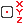

# { .rc-icon--title } Get Robtarget Members

Advanced RAPID Features tab
Fork addition
RAPID checked on IRB 1200 · RobotWare 6.10

**Get Robtarget Members** reads the parts of a `robtarget` [[RAPID Variable]] as separate
values: by default its X, Y and Z position. Right-click → *Get Rotation*, *Get Config* or
*Get External* to also output the quaternion, the configuration data and the external axes. Each output is a
[[type:RAPID Expression]], so it works anywhere an expression is accepted: in a
[[Comparison Expression]], an [[Offset Target]], an [[Assign Variable Value]] or a [[Return]].

[[io:Get Robtarget Members]]

## In RAPID

| Output | Writes | Means |
|---|---|---|
| X / Y / Z | `now.trans.x` … | position in mm |
| right-click › *Get Rotation* | `now.rot.q1` … `q4` | orientation quaternion |
| right-click › *Get Config* | `now.robconf.cf1` … | axis configuration |
| right-click › *Get External* | `now.extax.eax_a` … | external axis values |

The dot reads a *component* of a record: `now.trans` is the position part of `now`,
`now.trans.z` its Z value. ABB's reference:
[RAPID Instructions, Functions and Data types][abb-ifd] ([[abb:robtarget]], [[abb:pos]]).

Full example: [[Current Robot Target]] (returns `now.trans.z` from a function).

## Gotchas

!!! warning "Needs a robtarget *variable*"
    The input is a [[RAPID Variable]] of type `robtarget`, not a [[type:Robot Target]] or a
    [[Current Robot Target]] expression directly. Store the position in a variable first.

## See also

[[Current Robot Target]] · [[Offset Target]] · [[RAPID Variable]]
