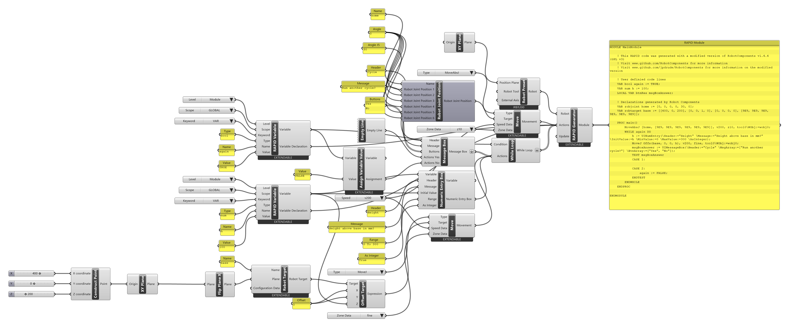

# { .rc-icon--title } Message Box

<span class="rc-badge">Advanced RAPID Features tab</span>
<span class="rc-badge rc-badge--fork">Fork addition</span>
<span class="rc-badge rc-badge--verified">RAPID syntax checked on IRB 1200 · RobotWare 6.10</span>

**Message Box** shows a dialog on the FlexPendant (the robot's handheld panel) with a
header, a message and up to five buttons, and waits until the operator presses one. For each
button it creates an *Actions …* input: whatever you wire there runs when that button is pressed.

[[io:Message Box]]

The *Actions* inputs appear (and disappear) as you change the *Buttons* list: one per button,
named after it (*Actions Yes*, *Actions No*).

## Example: an operator-driven loop

[:material-download: operator-loop.gh](../../examples/part-b/operator-loop.gh){ .md-button download="operator-loop.gh" }

<div class="rc-used" markdown>
<span>[[Message Box]]</span>
<span>[[Numeric Entry Box]]</span>
<span>[[While Loop]]</span>
<span>[[RAPID Variable]]</span>
<span>[[Assign Variable Value]]</span>
<span>[[Offset Target]]</span>
<span>[[Empty Line]]</span>
</div>

<div class="rc-canvas" markdown>

</div>

```
VAR bool again := TRUE;
VAR num h := 100;
LOCAL VAR btnRes msgBoxAnswer;                         ! (1)

PROC main()
    MoveAbsJ [home, [9E9, 9E9, 9E9, 9E9, 9E9, 9E9]], v200, z10, tool0\WObj:=wobj0;
    WHILE again DO                                     ! (2)
        h := UINumEntry(\Header:="Height" \Message:="Height above base in mm?"
            \InitValue:=h \MinValue:=0 \MaxValue:=300 \AsInteger);       ! (3)
        MoveJ Offs(base, 0, 0, h), v200, fine, tool0\WObj:=wobj0;
        msgBoxAnswer := UIMessageBox(\Header:="Cycle" \MsgArray:=["Run another cycle?"]
            \BtnArray:=["Yes", "No"]);                 ! (4)
        TEST msgBoxAnswer
        CASE 1:                                        ! Yes: nothing, loop again
        CASE 2:
            again := FALSE;                            ! No: end the loop
        ENDTEST
    ENDWHILE
ENDPROC
```

**Syntax checked on a Virtual Controller** (IRB 1200-5/0.9, RobotWare 6.10): the module
loads without errors. It wasn't simulated because the dialogs wait for a person to press a
button. (Generated lines are shown wrapped here.)

1. Message Box declares the variable that receives the answer (`btnRes`, the button number).
2. [[While Loop]] with the condition `again`, a [[RAPID Variable]] of type `bool`.
3. [[Numeric Entry Box]] asks for a height and stores it in `h`. A [[Move]] goes to
   [[Offset Target]] `Offs(base, 0, 0, h)`.
4. Message Box with buttons `Yes` and `No`. *Actions No* gets an [[Assign Variable Value]]
   `again := FALSE`; *Actions Yes* gets an [[Empty Line]] (see the bug below).

## In RAPID

`UIMessageBox` shows the dialog and returns the number of the pressed button, starting at
1. `TEST … CASE … ENDTEST` runs the block that matches the number. ABB's reference:
[RAPID Instructions, Functions and Data types][abb-ifd] ([[abb:UIMessageBox]], [[abb:TEST]], [[abb:btnres]]).

## Gotchas

!!! bug "Wire something into every button, or the wrong button acts"
    Buttons without actions are skipped when the `CASE` numbers are generated. With only
    *Actions No* wired, its actions end up in `CASE 1`, which is the **Yes** button. Until this
    is fixed, give every button at least an [[Empty Line]].

!!! warning "Flatten the output inside loops"
    Message Box outputs on a different data-tree branch than the other actions. In a
    [[While Loop]] this produced **two** separate loops. Right-click *Message Box* → **Flatten**.

## See also

[[Numeric Entry Box]] · [[While Loop]] · [[IF Statement]]
