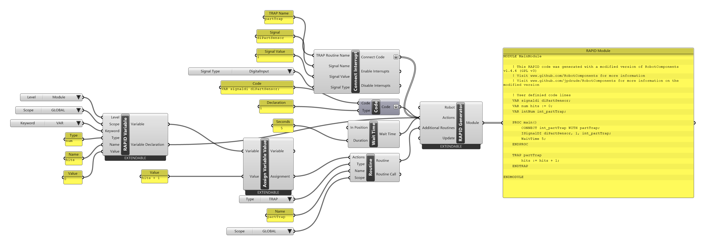

# { .rc-icon--title } Connect Interrupt

<span class="rc-badge">Advanced RAPID Features tab</span>
<span class="rc-badge rc-badge--fork">Fork addition</span>
<span class="rc-badge rc-badge--verified">RAPID syntax checked on IRB 1200 · RobotWare 6.10</span>

An **interrupt** lets the controller react to a signal *while it is doing something else*.
The robot keeps moving or waiting; when the signal changes, the controller pauses the
program, runs a **TRAP** routine, and carries on where it was. **Connect Interrupt** links a
signal to a TRAP routine you build with [[Routine]] (Type `TRAP`).

[[io:Connect Interrupt]]

*Signal Type* comes from a [[Signal Types]] drop-down: digital, analog or group input/output,
or **Persistent Data**, which watches a `PERS` variable instead of a signal. Right-click →
*Override Interrupt Variable Name* to connect several interrupts to the same TRAP.

For an **analog** signal the component adds a ***Condition*** input with its own drop-down
(*Always*, *Above*, *Below*, *Between* or *Outside*) and a ***Tolerance*** input. *Between* and
*Outside* also add a ***Low Value*** input; *Signal Value* is then the upper limit. The inputs
disappear again when you switch to another signal type. The drop-down starts at *Above* if a
*Signal Value* is connected, otherwise at *Always*.

*Tolerance* is RAPID's *DeltaValue*: after an interrupt, the signal has to change by more than
this before the next one can fire, so a noisy signal around the limit doesn't fire over and over.
Leave it empty for `0` (every change counts).

| *Condition* | Fires when the signal … | RAPID |
|---|---|---|
| Always | changes at all | `ISignalAI sig, AIO_ALWAYS, 0, 0, 0, int;` |
| Above | rises above *Signal Value* | `ISignalAI sig, AIO_ABOVE_HIGH, 2.5, 0, 0, int;` |
| Below | falls below *Signal Value* | `ISignalAI sig, AIO_BELOW_HIGH, 2.5, 0, 0, int;` |
| Between | is between *Low Value* and *Signal Value* | `ISignalAI sig, AIO_BETWEEN, 2.5, 1, 0, int;` |
| Outside | is outside *Low Value* … *Signal Value* | `ISignalAI sig, AIO_OUTSIDE, 2.5, 1, 0, int;` |

With a *Tolerance* of 0.2 the last number becomes `0.2`, e.g. `ISignalAI sig, AIO_OUTSIDE, 2.5, 1, 0.2, int;`.

## Example: count sensor hits

[:material-download: part-sensor-interrupt.gh](../../examples/part-b/part-sensor-interrupt.gh){ .md-button download="part-sensor-interrupt.gh" }

<div class="rc-canvas" markdown>

</div>

```
VAR signaldi diPartSensor;          ! placeholder, see below
VAR num hits := 0;
VAR intNum int_partTrap;                                   ! (1)

PROC main()
    CONNECT int_partTrap WITH partTrap;                    ! (2)
    ISignalDI diPartSensor, 1, int_partTrap;               ! (3)
    WaitTime 5;                                            ! (4)
ENDPROC

TRAP partTrap                                              ! (5)
    hits := hits + 1;
ENDTRAP
```

1. Every interrupt needs an `intNum` variable (an interrupt *identity*). Connect Interrupt declares it for you.
2. `CONNECT … WITH …` links that identity to the TRAP routine.
3. `ISignalDI` starts watching: digital input `diPartSensor`, trigger when it becomes `1`.
4. Something must keep running, or `main` ends before the sensor can trigger.
5. The [[Routine]] with Type `TRAP`. Its **Routine** output goes into the [[RAPID Generator]]'s
   *Additional Routines*.

**Syntax checked on a Virtual Controller** (IRB 1200-5/0.9, RobotWare 6.10): the module
loads without errors. The demo controller has no `diPartSensor`, so the example declares it as
a **placeholder** (`VAR signaldi diPartSensor;`) with a [[Code]] component. On a real cell,
**delete that line**: the signal comes from the controller's I/O configuration. Running the
interrupt needs the real signal.

## Which instruction for which signal

| Signal Type | With *Signal Value* | Without *Signal Value* (fires on every change) |
|---|---|---|
| Digital input / output | `ISignalDI sig, 1, int;` | trigger value `2` = both edges |
| Analog input / output | depends on *Condition* (table above) | *Condition* Always: `ISignalAI sig, AIO_ALWAYS, 0, 0, 0, int;` |
| Group input / output | *(not possible; warning)* | `ISignalGI sig, int;` |
| Persistent Data | *(not used; warning)* | `IPers myPers, int;` |

*Enable Interrupts* and *Disable Interrupts* give `IEnable;` and `IDisable;` lines. While
disabled, interrupts are queued, not lost, and run when you enable again.
ABB's reference: [RAPID Instructions, Functions and Data types][abb-ifd]
([[abb:CONNECT]], [[abb:ISignalDI]], [[abb:ISignalAI]], [[abb:ISignalGI]], [[abb:IPers]], [[abb:IEnable]], [[abb:IDisable]]).

## Gotchas

!!! info "Switching away from Between / Outside"
    *Low Value* is removed when you pick another condition or signal type, and with it its wire.
    Reconnect it when you switch back.

!!! tip "Keep TRAP routines short"
    A TRAP interrupts the program. Set a flag or count, as here, and let `main` react,
    rather than moving the robot inside the TRAP.

## See also

[[Routine]] · [[Signal Types]] · [[Code]] · [[Wait for Digital Input]]
