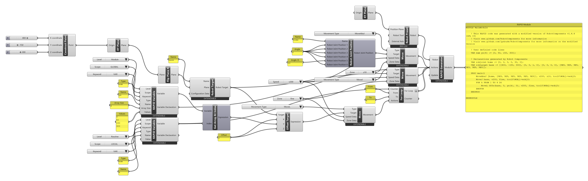

# Tutorial: looping over an array

<span class="rc-badge rc-badge--fork">Fork addition</span>
<span class="rc-badge rc-badge--verified">RAPID checked on IRB 1200 · RobotWare 6.10</span>

In the [row tutorial](row-loop.md) the points were evenly spaced (`i * 100`). When the
spacing is irregular, store the values in an **array**: one variable holding a list, read
element by element in a loop.

[:material-download: array-offsets.gh](../../examples/part-b/array-offsets.gh){ .md-button download="array-offsets.gh" }

<div class="rc-used" markdown>
<span>[[RAPID Variable]]</span>
<span>[[Get Array At Index]]</span>
<span>[[For Loop]]</span>
<span>[[Offset Target]]</span>
<span>[[Move]]</span>
</div>

<div class="rc-canvas" markdown>

</div>

```
VAR num ys{4} := [0, 50, 150, 300];                    ! (1)

PROC main()
    MoveAbsJ [home, [9E9, 9E9, 9E9, 9E9, 9E9, 9E9]], v200, z10, tool0\WObj:=wobj0;
    MoveJ base, v200, fine, tool0\WObj:=wobj0;
    FOR k FROM 1 TO 4 DO                                ! (2)
        MoveL Offs(base, 0, ys{k}, 0), v200, fine, tool0\WObj:=wobj0;   ! (3)
    ENDFOR
ENDPROC
```

**Checked on a Virtual Controller** (IRB 1200-5/0.9, RobotWare 6.10): runs with no
warnings, cycle time **5.1 s**. (Other declarations and header comments not shown.)

1. [[RAPID Variable]], right-click → **Set Array Size**. It gets *Array Size* `4` and a
   *Values* list (a [[gh:Panel]] with `0`, `50`, `150`, `300`), Type `num`, Name `ys`.
2. A second [[RAPID Variable]] `k` (Type `num`, Level `Routine`, Scope `LOCAL`) is the
   counter. It goes into the [[For Loop]]'s *Counter* **and** into [[Get Array At Index]]'s
   *Index*. *From* `1`, *To* `4`: RAPID arrays start at **1**.
3. [[Get Array At Index]] gives `ys{k}`, used as *Y* of an [[Offset Target]]; a `MoveL`
   goes there.

!!! warning "Use a counter variable, not the loop's *Counter* output"
    Wiring the [[For Loop]]'s *Counter* output into components inside the same loop makes
    the loop depend on itself. Grasshopper stops with *"Recursive data stream found"*. Create the
    counter as a [[RAPID Variable]] and wire it into both places, as here.

## Try it

- [ ] Add a fifth point at Y = 400. Which three inputs change?

??? success "Solution"
    *Array Size* `5`, a fifth line `400` in the *Values* panel, and the loop's *To* `5`.
