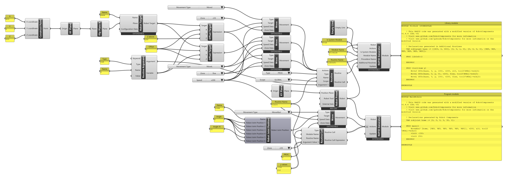

# Tutorial: a routine library

<span class="rc-badge rc-badge--fork">Fork addition</span>
<span class="rc-badge rc-badge--verified">RAPID checked on IRB 1200 · RobotWare 6.10</span>

The [[Routine]] example puts the routine into the same module as the program that uses it.
For routines you need in **many** programs (approach, tool change, calibration moves), put
them into a **library**: a separate **system module** that stays loaded on the controller.
Every program can then call them.

[:material-download: routine-library.gh](../../examples/part-b/routine-library.gh){ .md-button download="routine-library.gh" }

<div class="rc-used" markdown>
<span>[[RAPID Generator]]</span>
<span>[[Routine]]</span>
<span>[[Routine Argument]]</span>
<span>[[Routine Call]]</span>
<span>[[Offset Target]]</span>
<span>[[Empty Line]]</span>
</div>

<div class="rc-canvas" markdown>

</div>

## Two generators, two modules

**The library** (upper [[RAPID Generator]]). Right-click → *Is System Module*,
*Overwrite Module Name*, *Overwrite Routine Name*, *Add Additional Routines*:

```
MODULE PickLib (SYSMODULE)
    VAR robtarget base := [[400, 0, 300], [0, 0, 1, 0], [0, 0, 0, 0], [9E9, 9E9, 9E9, 9E9, 9E9, 9E9]];

    PROC libInfo()
    ENDPROC

    PROC visit(num y)
        MoveJ Offs(base, 0, y, 100), v200, z10, tool0\WObj:=wobj0;
        MoveL Offs(base, 0, y, 0), v200, fine, tool0\WObj:=wobj0;
        MoveL Offs(base, 0, y, 100), v200, fine, tool0\WObj:=wobj0;
    ENDPROC
ENDMODULE
```

**The program** (lower [[RAPID Generator]]), as usual:

```
MODULE MainModule
    VAR robjoint home := [0, 0, 0, 0, 30, 0];

    PROC main()
        MoveAbsJ [home, [9E9, 9E9, 9E9, 9E9, 9E9, 9E9]], v200, z10, tool0\WObj:=wobj0;
        visit -150;
        visit 150;
    ENDPROC
ENDMODULE
```

(Header comments removed.)

**Checked on a Virtual Controller** (IRB 1200-5/0.9, RobotWare 6.10): the library module
loads on its own; library and program together run in **6.5 s**. The verifier loads one module
at a time, so for the run both parts were put into one module. The upload of `PickLib` as a
separate system module wasn't tested. The run gave one warning, *50501 Short movements* on the
first MoveAbsJ, because the controller was already standing in that home pose.

## Step by step

1. Build the routine as in the [[Routine]] example: `PROC visit(num y)` with three Moves to
   [[Offset Target]]s of `base`. Its **Routine** output goes into the library generator's
   *Additional Routines*.
2. The library generator: *Is System Module* `True`, *Module Name* `PickLib`. It needs at least
   one action, so give it an [[Empty Line]].
3. **Rename its main routine** (*Overwrite Routine Name*, here `libInfo`). Otherwise the library
   brings its own `PROC main()`, and a task can't have two routines with the same name.
4. The program generator: a home move, then a [[Routine Call]] (`visit`, values `-150` and
   `150`). It doesn't contain the routine itself; it only calls it.
5. **On the controller:** upload `PickLib` once as a system module ([[Upload Program]] with
   *Is System Module*, or [[Upload Helper Modules]]), then upload and run `MainModule` as often
   as you like.

!!! info "System module or Load Module?"
    A **system module** is loaded once and stays, so its routines are always known: the program
    can call `visit` directly. [[Load Module]] loads modules **while the program runs**. Routines
    in such a module don't exist yet when the program itself is loaded, so a direct call stops
    the program from loading. Call them late-bound instead: give the [[Routine Call]] the
    *Module Name* (`%"PickLib:visit"% 150;`). For a library you always need, a system module is
    simpler.

## Try it

- [ ] Add a second library routine `retract` that moves 200 mm up from the current position. *(Hint: [[Current Robot Target]] and [[Offset Target]].)*

??? success "Solution"
    A second [[Routine]] (`PROC`, Name `retract`, no arguments) whose *Actions* is one [[Move]]
    ([[abb:MoveL]], `fine`) to an [[Offset Target]] with *Target* = the *Expression* output of
    [[Current Robot Target]] and *Z* `200`. Wire it into the library generator's
    *Additional Routines* too, and call it from the program with a [[Routine Call]] (`retract`):

    ```
    PROC retract()
        MoveL Offs(CRobT(), 0, 0, 200), v200, fine, tool0\WObj:=wobj0;
    ENDPROC
    ```

    Checked on a Virtual Controller: `visit 150;` then `retract;` runs with no warnings.

## See also

[[Routine]] · [[Routine Call]] · [[Load Module]] · [[Upload Program]]
