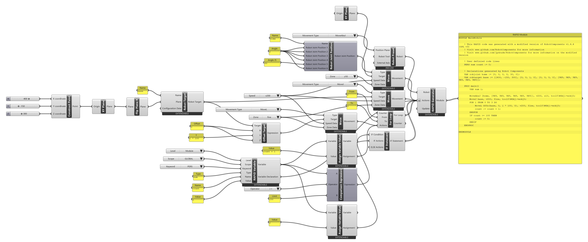

# Tutorial: a row of points with a loop

<span class="rc-badge rc-badge--fork">Fork addition</span>
<span class="rc-badge rc-badge--verified">RAPID checked on IRB 1200 · RobotWare 6.10</span>

In Part A, four points meant four targets and four movements. Here the **controller**
computes the points: one target, one [[Move]] inside a [[For Loop]], and the loop counter
shifts the target with [[abb:Offs]]. A persistent counter remembers how many points were visited
across runs, and an [[IF Statement]] resets it at 100.

Read the [B0 RAPID primer](../b0-rapid-primer.md) first if `VAR`, `PERS` and `:=` are new to you.

[:material-download: row-loop.gh](../../examples/part-b/row-loop.gh){ .md-button download="row-loop.gh" }

**Components used**

<div class="rc-used" markdown>
<span>[[RAPID Variable]]</span>
<span>[[Assign Variable Value]]</span>
<span>[[For Loop]]</span>
<span>[[Offset Target]]</span>
<span>[[Comparison Expression]]</span>
<span>[[IF Statement]]</span>
<span>[[Move]]</span>
<span>[[Robot Target]]</span>
<span>[[Flip Plane X]]</span>
<span>[[RAPID Generator]]</span>
</div>

<div class="rc-canvas" markdown>

</div>

## The generated program

```
MODULE MainModule
    PERS num count := 0;                                     ! (1)
    VAR robjoint home := [0, 0, 0, 0, 30, 0];
    VAR robtarget base := [[400, -150, 300], [0, 0, 1, 0], [0, 0, 0, 0], [9E9, 9E9, 9E9, 9E9, 9E9, 9E9]];

    PROC main()
        VAR num i;                                           ! (2)

        MoveAbsJ [home, [9E9, 9E9, 9E9, 9E9, 9E9, 9E9]], v200, z10, tool0\WObj:=wobj0;
        MoveJ base, v200, fine, tool0\WObj:=wobj0;
        FOR i FROM 0 TO 3 DO                                 ! (3)
            MoveL Offs(base, 0, i * 100, 0), v200, fine, tool0\WObj:=wobj0;   ! (4)
            count := count + 1;                              ! (5)
        ENDFOR
        IF count >= 100 THEN                                 ! (6)
            count := 0;
        ENDIF
    ENDPROC
ENDMODULE
```

**Checked on a Virtual Controller** (IRB 1200-5/0.9, RobotWare 6.10): runs with no
warnings, cycle time **5.1 s**. (Header comments removed.)

## Step by step

1. **A persistent counter.** [[RAPID Variable]] with *Keyword* `PERS`, *Type* [[abb:num]], *Name*
   `count`, *Value* `0`. When you place it, it creates its own *Level*, *Scope* and
   *Keyword* drop-downs. Its **Variable Declaration** output goes into the
   [[RAPID Generator]]'s *Actions*, which writes line (1).
2. **The base point.** [[gh:Construct Point]] → [[gh:XY Plane]] → [[Flip Plane X]] →
   [[Robot Target]] named `base`. A [[Move]] with [[abb:MoveJ]] goes there first.
3. **The loop.** [[For Loop]] with *From* `0` and *To* `3`. *Counter* is left empty, so the
   component declares `VAR num i` for you (2) and runs the body four times: `i` = 0, 1, 2, 3.
4. **The moving target.** [[Offset Target]] takes `base` and offsets it by
   *Y* = `i * 100`, a RAPID expression typed into a [[gh:Panel]]. The controller evaluates it
   on every pass, giving Y offsets 0, 100, 200 and 300 mm (4). A [[Move]] with [[abb:MoveL]]
   goes there.
5. **Counting.** [[Assign Variable Value]] with the counter's *Variable* output and *Value*
   `count + 1` writes (5). Both the Move and the assignment go into the loop's *Actions*,
   in that order.
6. **Resetting.** [[Comparison Expression]] builds `count >= 100` (A = the counter,
   Operator `>=`, B = `100`). An [[IF Statement]] runs a second [[Assign Variable Value]]
   (`count := 0`) when it is true (6).
7. **Generate.** *Actions* of the [[RAPID Generator]], in order: the counter's declaration,
   the home Move, the base Move, the For Loop, the IF Statement. *Actions* is flattened.

!!! info "Wire order is program order"
    [[For Loop]], [[While Loop]], [[IF Statement]] and the other components that write a block
    of RAPID output on the same data-tree branch as a [[Move]], also when loops are nested. The
    order of the wires into *Actions* is the order of the program.

!!! info "What the Path Generator can show"
    The offsets `i * 100` only exist on the controller. Grasshopper cannot know `i`, so the
    loop's movements can't be previewed with the [[Path Generator]]. Offsets that are plain
    numbers can.

## Try it

- [ ] **More points, smaller steps.** Visit 6 points, 50 mm apart. Which two inputs change?
- [ ] **Two rows.** Wrap the loop in a second [[For Loop]] that moves the row in X. Leave its *Counter* empty: the inner loop already counts with `i`, so the outer one counts with `j`. What does the *X* input of [[Offset Target]] become?
- [ ] **Counting runs, not points.** Move the `count := count + 1` out of the loop so it counts program runs. Where do you wire it?

??? success "Solutions"
    1. *To* becomes `5` and *Y* becomes `i * 50`.
    2. `j * 100`. The inner loop goes into the outer loop's *Actions*; the outer loop goes into
       the generator in place of the inner one. The result
       (`FOR j FROM 0 TO 1 DO FOR i FROM 0 TO 3 DO MoveL Offs(base, j * 100, i * 100, 0) …`)
       loads on the Virtual Controller.
    3. Directly into the [[RAPID Generator]]'s *Actions*, after the For Loop and before the IF Statement, instead of into the loop's *Actions*.
